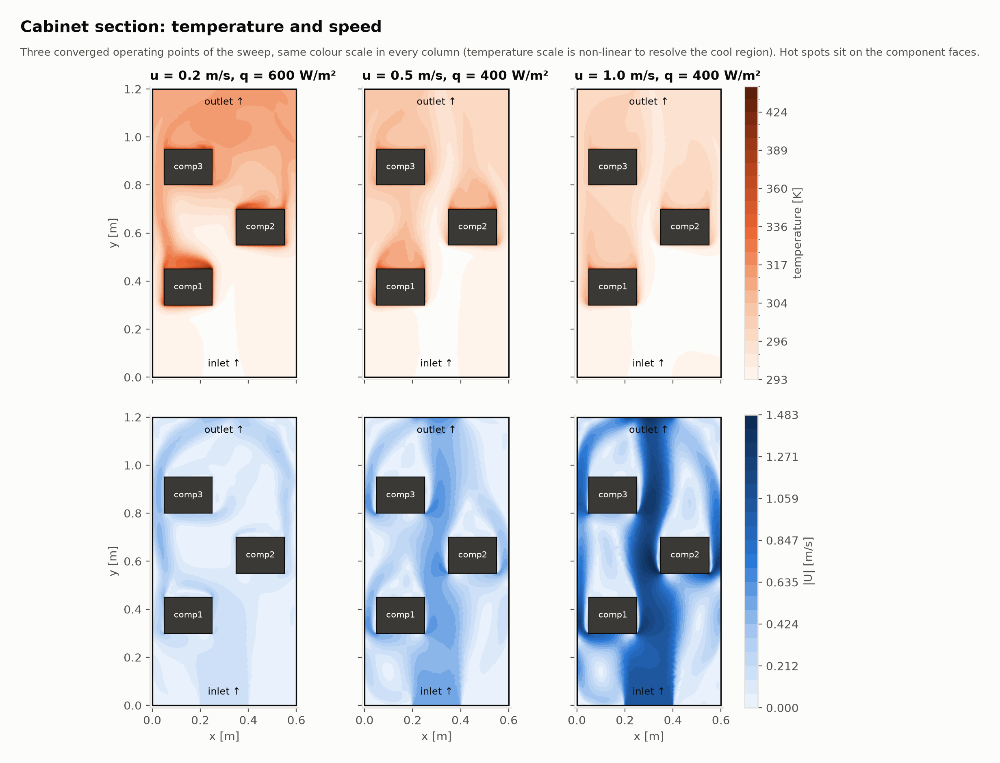
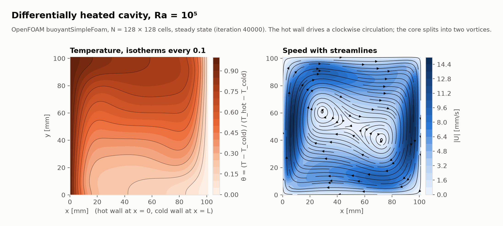
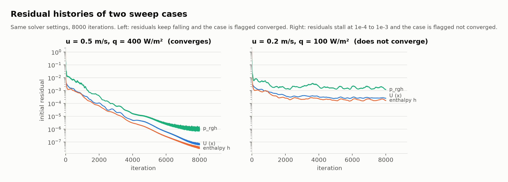
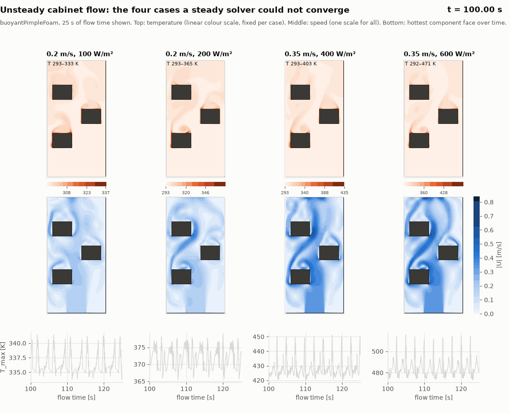
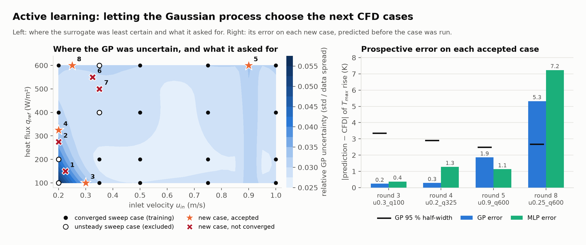
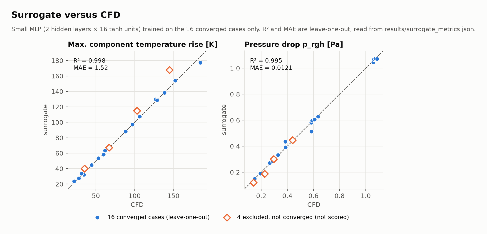

# Natural convection (Buoyancy-driven) CFD simulation, validated, with an ML surrogate

**OpenFOAM (ESI v2606) · Gmsh · Python · scikit-learn**

> *This project was carried out with AI assistance (Claude Code).*



## What this project is

Electronics cabinets are cooled by air that moves because it is pushed (a fan) and because it is hot (buoyancy). Predicting the hottest component temperature normally needs a CFD run that takes minutes to hours. This project asks four questions and answers them in order:

1. **Can I trust my OpenFOAM buoyancy setup?** I test it on a famous benchmark with a known answer: the differentially heated square cavity (de Vahl Davis, 1983).
2. **How does a cabinet respond to airflow and heat load?** I build a parametric 2D cabinet with three heat-emitting components and run 20 steady simulations over a grid of inlet velocities and heat loads (and re-run the four that turn out to be unsteady with a transient solver).
3. **How far can I trust the numbers?** I check the cabinet with a mesh study, a second-order-scheme restart, a transient sensitivity test and an active-learning round (all in Part 2). The honest answer is in the table below: the trends are solid, the absolute temperatures are not mesh-converged.
4. **Can a small model replace the CFD?** I train a small neural network (a *surrogate*) on the 16 converged results to predict the maximum component temperature and the pressure drop instantly.

It carries over the workflow of my Master's thesis (parametrised CFD cases, correlation of results, validation) to an open-source toolchain that runs on a laptop.

## Results at a glance

| | Result |
|---|---|
| **Validation** | Hot-wall Nusselt number 4.524 on the finest mesh vs 4.519 in the benchmark: **+0.11 %**. Hot/cold heat balance below 0.001 %. |
| **Mesh convergence** | Error 0.44 % → 0.19 % → 0.11 % over three meshes; GCI(fine) = 0.04 %. |
| **Cabinet sweep** | 20 cases, **16 meet my steady convergence criterion, 4 do not**. Those 4 are unsteady (low velocity, buoyancy-dominated): I re-ran them transient, and their time-averaged T_max is 8 to 47 K higher than the steady value. T_max of the 16 converged cases: 315 K to 478 K, pressure drop 0.15 Pa to 1.09 Pa. |
| **Cabinet mesh study** | Not mesh-converged: T_max rise is 10 to 14 % higher on a 2× finer mesh (4 cases, apparent order below 1, GCI 30 to 48 %). |
| **Second-order scheme** | `linearUpwind` raises T_max by 10 to 72 K and the steady solution stops being steady; the steady `upwind` values are biased low. |
| **Inlet turbulence** | Inlet k changed by 0.1 to 100 times on 3 cases: T_max moves by less than 1 K and dp by at most 5.5 % up to 10 times; only an unrealistic 26 to 52 % intensity moves T_max by 1.4 to 7.2 K. |
| **Radiation** | Adding surface radiation (`fvDOM`, transparent air) lowers T_max by 5 to 64 K on three cases (emissivity 0.9 and 0.3); the components radiate 10 to 31 % of their power to the shell and the openings. The sweep without radiation is biased high. |
| **3D slice** | Same cross-section with 12 cells through the depth and no-slip side panels (272k cells): pressure drop is 16 to 20 % higher in all three cases; T_max changes by +8.9 K and −0.4 K in the two converged cases, and the third case (low velocity) stays unsteady in 3D. |
| **Conjugate heat transfer** | Components meshed as solids with a volumetric heat source (conductivity 200 and 5 W/(m K)): T_max is 12 to 74 K lower than in the sweep, but the mean surface temperature changes by only 0.4 to 2.6 K. The sweep's T_max is a hot-spot value of a prescribed flux. |
| **Transient-aware surrogate** | Tried on 28 cases (8 unsteady, all run transient). Error on the unsteady cases falls from 16.4 to 8.4 K, but over all cases it is not better (7.1 vs 6.5 K) because the regime classifier fails (64 %, below the 71 % of always answering "steady"). The offset and fluctuation models alone beat their baselines. |
| **Surrogate** | Trained on the 16 converged cases only. Leave-one-out R² = 0.998 (temperature rise) and 0.995 (pressure drop). About 10⁶ times faster than one CFD run. |

The honest caveats are in [Limitations](#limitations); please read them before using any number.

## Contents

- [Quick start](#quick-start)
- [Repository layout](#repository-layout)
- [Part 1: validation on the heated cavity](#part-1-validation-on-the-heated-cavity)
- [Part 2: the cabinet and its parameter sweep](#part-2-the-cabinet-and-its-parameter-sweep)
- [Mesh study, second-order scheme, transient sensitivity, active learning, inlet turbulence, radiation, 3D slice, conjugate heat transfer, transient-aware surrogate](#mesh-study-for-the-cabinet) (in Part 2)
- [Part 3: the surrogate model](#part-3-the-surrogate-model)
- [Decisions and what I changed](#decisions-and-what-i-changed)
- [Assumptions and simplifications](#assumptions-and-simplifications)
- [Limitations](#limitations)
- [Porting notes](#porting-notes) · [References](#references) · [License](#license)

## Quick start

Requirements: OpenFOAM ESI **v2606** ([openfoam.com](https://www.openfoam.com); not the Foundation releases, where several names differ, see [Porting notes](#porting-notes)), Python 3.9+, Linux or WSL2. Everything runs on a laptop.

```bash
# one-time: Python packages (a virtualenv avoids the "externally managed environment" error)
python3 -m venv ~/.venvs/cabinet && source ~/.venvs/cabinet/bin/activate
pip install -r requirements.txt

source /usr/lib/openfoam/openfoam2606/etc/bashrc   # or the path of your own install
sh scripts/check_env.sh                            # must end with "Environment ready."

./run_all.sh smoke                  # quick check that both cases run (cavity at the N in meshParams + one coarse cabinet case)
./run_all.sh cavity                 # 3-mesh study            -> results/cavity_*  and docs/img/cavity_*
JOBS=2 ./run_all.sh cabinet         # mesh + 20 cases         -> results/sweep_results.csv
python3 scripts/continue_unconverged.py   # continue the unconverged cases with lower relaxation and 2000 more iterations
JOBS=2 ./run_all.sh transient       # transient re-run of the cases still unconverged + animation + recirculation check
./run_all.sh ml                     # surrogate + summary     -> results/RESULTS.md
JOBS=4 ./run_all.sh studies         # cabinet mesh study, linearUpwind restart, transient sensitivity, active learning (several hours; needs the converged cases in cabinet_case/runs for the restart test)

python3 -m unittest discover -s tests   # unit tests of the Python helpers (no OpenFOAM needed)
```

## Repository layout

```
validation_cavity/     OpenFOAM case: Ra = 1e5 cavity (blockMesh, laminar buoyantSimpleFoam)
  case_params.json     fluid properties, temperatures, L, reference Nu (single source of truth)
cabinet_case/          OpenFOAM template for the cabinet
  transient_template/  transient (PIMPLE) dictionaries for run_transient.py
  0.orig/              initial fields with @placeholders@ for inlet velocity and heat fluxes
  Allmesh, Allclean    Gmsh -> gmshToFoam -> patch types -> checkMesh
run_all.sh             entry point: smoke | cavity | cabinet | transient | ml | all
scripts/
  cabinet_mesh_study.py   3-mesh study of 4 cabinet cases + GCI
  linear_upwind_study.py  restart converged cases with linearUpwind (+ upwind control)
  transient_sensitivity.py time step / run length sensitivity of one transient case
  active_learning.py      GP-uncertainty-driven choice of new CFD cases
  transient_active.py     transient runs of the four unsteady active-learning proposals
  transient_surrogate.py  regime classifier + offset models for the unsteady cases, leave-one-out with baselines
  inlet_turbulence_study.py inlet k x0.1 to x100 on 3 converged cases (T_max, dp vs sweep)
  radiation_study.py      fvDOM surface radiation on 3 cases x 2 emissivities + radiative heat balance
  slice3d_study.py        3D slice (12 cells through the depth, side panels as walls), 3 cases on 6 cores
  cht_study.py            conjugate heat transfer: components as solid regions with a heat source, 3 cases x 2 conductivities
  check_env.sh         preflight: OpenFOAM environment, tools, Python packages
  check_rayleigh.py    verifies that the cavity really has Ra = 1e5
  mesh_study.py        3-mesh study: Nu, error vs benchmark, GCI
  extract_nusselt.py   Nu from the wallHeatFlux output + hot/cold heat balance
  gci.py               Grid Convergence Index (Celik et al. 2008)
  make_cabinet_mesh.py Gmsh (Python API): geometry, patches, size field
  fix_boundary.py      sets wall / empty / patch types after gmshToFoam
  run_sweep.py         parametric sweep: copy case, fill placeholders, run, collect
  continue_unconverged.py continuation of non-converged cases: lower relaxation, restart, run on
  run_transient.py     transient (buoyantPimpleFoam) re-run of the cases that stay unconverged
  make_movie.py        restarts the transient cases with fine output and renders docs/img/transient_cabinet.gif
  recirculation.py     share of cells with reverse vertical flow, per case
  parse_foam.py        reads patch values and run time from ASCII OpenFOAM output
  train_surrogate.py   MLP surrogate, hold-out + leave-one-out, speed-up
  make_figures.py      builds every figure in docs/img/ from the real data
  summarize_results.py collects all numbers into results/RESULTS.md
tests/                 unit tests for the Python helpers
results/               CSVs, JSON and RESULTS.md written by the scripts (solver output itself is not stored in the repo)
docs/img/              figures used in this README
```

## Part 1: validation on the heated cavity

### The benchmark

A square box of air, hot on the left wall, cold on the right, insulated top and bottom. The hot air rises along the left wall, the cold air sinks along the right wall, and a circulation sets up. The strength of the buoyancy is set by the Rayleigh number; I use **Ra = 10⁵**. The quantity of interest is the **average Nusselt number** Nu on the hot wall, which is the heat actually transferred divided by what pure conduction would transfer. de Vahl Davis (1983) published a reference value of **4.519** for this case.

If my solver, boundary conditions and numerics are right, I must get close to 4.519, and the error must shrink when the mesh is refined.

| Item | Value |
|---|---|
| Geometry | square, L = 0.10116 m, one cell in z (`empty` front/back) |
| Fluid | air, ideal gas, μ = 1.8e-5 Pa s, Cp = 1005 J/(kg K), Pr = 0.71 |
| Walls | hot 300.5 K (x = 0), cold 299.5 K (x = L), top and bottom adiabatic, no-slip |
| Dimensionless numbers | Ra = g β ΔT L³ / (ν α) = 1.0e5, Pr = 0.71 (checked by `scripts/check_rayleigh.py`) |
| Solver | `buoyantSimpleFoam` (steady SIMPLE), laminar |
| Schemes | steady state, bounded Gauss `linearUpwind` for U and h |
| Relaxation | 0.3 for U and h, 0.7 for p_rgh |
| Mesh | wall-clustered single block, N = 32, 64, 128 cells per side (refinement ratio 2) |
| Metric | Nu = Q / (κ ΔT depth), with Q the heat flow from the `wallHeatFlux` function object |



*Left: temperature as θ = (T − T_cold)/(T_hot − T_cold) with isotherms every 0.1. Right: speed with streamlines. The hot wall drives a clockwise circulation, with thin fast boundary layers on the side walls and a core that splits into two vortices.*

### Results

| N | cells | Nu | error vs 4.519 |
|---|---|---|---|
| 32 | 1 024 | 4.539 | +0.44 % |
| 64 | 4 096 | 4.527 | +0.19 % |
| 128 | 16 384 | 4.524 | +0.11 % |

Apparent order of convergence p = 1.77, Richardson-extrapolated Nu = 4.5226, **GCI(fine) = 0.04 %**, convergence is monotonic. The hot/cold heat balance is below 0.001 %. (Source: `results/cavity_mesh_study.csv`, `results/cavity_gci.json`.)


**How to read this.** The three Nusselt numbers move steadily toward the benchmark as the mesh is refined, and the extrapolated value (4.5226) is 0.08 % from the reference. That is the behaviour I expect from a correct setup.

**About the benchmark value.** 4.519 is the number in `case_params.json`. I found it as the de Vahl Davis reference for Ra = 10⁵ in a comparison table of [Spectral element simulations of buoyancy-driven flow](https://arxiv.org/pdf/physics/0305049), and the [Cardinal (MOOSE) verification page](https://cardinal.cels.anl.gov/vv/square_cavity_natural_convection.html) quotes the same value. Both are secondary sources. The original paper (Int. J. Numer. Methods Fluids 3, 249–264, 1983) is behind a paywall and I have not read its table.

**What differs from the benchmark.** The benchmark assumes the Boussinesq approximation; my case uses a weakly compressible ideal gas with ΔT = 1 K, a small effect. The steady runs stop at a finite iteration count; none met my strict residual limits (U 1e-7, h 1e-8), so I judge convergence on the heat flux instead: at N = 128 it changes by less than 1e-5 (relative) over the last 1500 iterations (1.15265e-3 W to 1.15266e-3 W), and the heat balance is below 0.001 %.

## Part 2: the cabinet and its parameter sweep

### The model

- A 2D section of a cabinet, 0.6 m wide and 1.2 m tall, 0.1 m deep, with a 0.2 m inlet slot in the bottom wall and a 0.2 m outlet slot in the top wall.
- Three rectangular components (0.2 m × 0.15 m) that emit a prescribed heat flux: `q1 = q_ref`, `q2 = 0.6 q_ref`, `q3 = 0.3 q_ref`.
- Air at 293.15 K enters at velocity `u_in`; the cabinet shell is adiabatic.
- `buoyantSimpleFoam`, steady, k-ω SST turbulence with wall functions, 22 636 cells (one cell through the thickness), made in Gmsh with small cells at walls and components and large cells in the free stream.
- Sweep: `u_in` ∈ {0.2, 0.35, 0.5, 0.75, 1.0} m/s × `q_ref` ∈ {100, 200, 400, 600} W/m² = **20 cases**.
- Outputs per case: maximum component temperature `T_max_K`, pressure difference inlet to outlet `dp_Pa` (from `p_rgh`, so the hydrostatic part is excluded), a convergence flag, and the solver time.

The figure at the top of this page shows three of the converged cases: slow air with high load (left), medium (centre), fast air (right). With fast air the hot spots are limited to thin layers on the component faces; with slow air they spread into a warm plume.

### Sweep results


*Maximum component temperature (left) and pressure drop (right) over the 5 × 4 grid. Hatched cells did not meet the convergence criterion.*

Two patterns are visible: more heat gives a higher T_max at every velocity, and T_max generally falls as the velocity rises (not strictly in every cell, and several of the cells that break the trend are the non-converged ones). The pressure drop depends mainly on velocity: about 1.06 to 1.09 Pa at 1 m/s and 0.15 to 0.59 Pa at 0.5 m/s or less (converged cases).

### Convergence: which cases to trust

I call a case **converged** when `T_max` changed by less than 0.05 K between the last two write times. After the main sweep (8000 iterations) **14 of 20 cases met this**. I then continued each of the 6 others, one at a time, with lower relaxation (U and h 0.15 → 0.1, k and ω 0.3 → 0.2), restarted from the saved state and run for 2000 more iterations (to 10000). This is `scripts/continue_unconverged.py`. The outcome:

| Case | After the main sweep (8000 iterations) | After continuation (10000 iterations) |
|---|---|---|
| `u0.75_q600` | not converged | **converged**, residuals about 1e-6 |
| `u0.2_q400` | not converged | **converged**, but marginal: it passes the 0.05 K test while the residuals are still about 2.5e-4 |
| `u0.2_q100` | not converged | not converged |
| `u0.2_q200` | not converged | not converged |
| `u0.35_q400` | not converged | not converged |
| `u0.35_q600` | not converged | not converged |

**16 of 20 cases now meet the criterion; these 4 do not:** `u0.2_q100`, `u0.2_q200`, `u0.35_q400`, `u0.35_q600`. They are kept in `results/sweep_results.csv` (column `converged`) and hatched in the figure above; I did not drop them from the data, only from the surrogate training set (Part 3). The state after the main sweep is kept next to the final values in the columns `T_max_8000it_K`, `dp_8000it_Pa` and `converged_8000it`.



*Residual histories of one converged and one non-converged case from the main sweep, same solver settings. Left: the residuals keep falling. Right: they stall at 1e-4 to 1e-3.*

The four remaining cases looked like a flow that keeps oscillating, not one that is slowly settling: over the last five write times (iterations 8750 to 10000) `T_max` still varied by 0.8 K (`u0.2_q100`), 1.7 K (`u0.2_q200`), 5.1 K (`u0.35_q400`) and 3.0 K (`u0.35_q600`), and the residuals stayed at 1e-4 to 3e-4. More iterations at lower relaxation did not change that, so I tested the explanation with a transient solver (next section).

### The four stubborn cases, run transient

**Why I switched from a steady to a transient solver.** A steady solver (`buoyantSimpleFoam`) looks for one fixed flow field. For these four cases it never found one: after 8000 iterations `T_max` kept changing between saved iterations, the residuals stalled at 1e-4 to 3e-4 instead of falling, and lowering the relaxation and adding 2000 iterations did not help. That pattern points to a flow that is physically unsteady, where no single steady answer exists, not to a solver that needs more time. A transient solver (`buoyantPimpleFoam`) follows the flow through time and can test this directly. It did: the flow fluctuates, and its time average is a well-defined result.

`scripts/run_transient.py` re-runs each of the four with `buoyantPimpleFoam` (implicit Euler, Courant number below 0.8, same mesh, properties and boundary conditions), starting from the last steady fields and running for 100 s of flow time. It records `T_max` and the pressure drop at every time step (`results/transient_results.csv`). Statistics use the second half of the run; I discarded the first half as start-up.

| Case | T_max steady (K) | T_max transient: mean (K) | std (K) | min to max (K) | Mean drift between the last two quarters (K) | dp steady (Pa) | dp transient mean (Pa) |
|---|---|---|---|---|---|---|---|
| `u0.2_q100` | 328.4 | 336.4 | 1.8 | 333.7 to 341.4 | 0.03 | 0.140 | 0.106 |
| `u0.2_q200` | 360.0 | 371.9 | 3.0 | 365.3 to 378.4 | 0.01 | 0.226 | 0.188 |
| `u0.35_q400` | 396.1 | 428.7 | 6.6 | 420.4 to 451.0 | 0.11 | 0.296 | 0.263 |
| `u0.35_q600` | 438.1 | 484.8 | 8.4 | 473.6 to 514.8 | 0.04 | 0.441 | 0.349 |

What this shows:

- **The flow really is unsteady.** T_max fluctuates with a standard deviation of 1.8 to 8.4 K, and the fluctuation grows with heat load and velocity in this set. A steady solver has no fixed point to reach, which explains the stalled residuals.
- **The steady values were not just noisy, they were biased low.** The transient mean T_max is 8 to 47 K higher than the last steady iterate, and the mean pressure drop is 0.03 to 0.09 Pa lower. The steady numbers for these four cases in `results/sweep_results.csv` should therefore not be used.
- **The averages are stationary** (the mean changes by 0.01 to 0.11 K between the last two quarters of the averaging window), so the transient means are well-defined values. The project surrogate in Part 3 does **not** use them; I tried them in a separate model (see [Transient-aware surrogate](#transient-aware-surrogate)). Sensitivity to the time step and the 100 s length was tested for one case only (see [Transient sensitivity](#transient-sensitivity-one-case)); the convection scheme was not varied (the transient runs use `linearUpwind` for U and `limitedLinear` for h, not the `upwind` of the steady sweep, so the two sets are not like-for-like).



*25 s of flow time (t = 100 to 125 s) of the four cases, one column each. Top: temperature (linear colour scale, fixed per case). Middle: speed. Bottom: T_max of the hottest component face, with the part already played drawn in orange. Made by `scripts/make_movie.py`: I restarted each case from t = 100 s and wrote a field every 0.25 s.*

In the animation the speed field shows swirling structures that keep changing shape and position between frames, and the T_max curves show repeated spikes every few seconds (roughly periodic, not random). The temperature field changes more subtly, because the hot air stays in thin layers close to the components. This continuing motion is what the steady solver could not settle on. The GIF is about 5.5 MB; each frame is real solver output, nothing is interpolated.

### Does low velocity cause flow separation?

I expected that low inlet velocity would give more recirculation, so I checked (`scripts/recirculation.py`, `results/recirculation.csv`). As a crude indicator I counted the share of cells whose vertical velocity points downward, against the main upward flow:

| Inlet velocity (m/s) | Cells with downward flow (mean over the 4 heat loads, steady runs) |
|---|---|
| 0.2 | 26.2 % |
| 0.35 | 31.5 % |
| 0.5 | 33.3 % |
| 0.75 | 31.0 % |
| 1.0 | 30.0 % |

**Recirculation is present at every velocity: roughly a quarter to a third of the cabinet cells have reverse vertical flow, and that share is not larger at low velocity.** The strength of the reverse flow scales with the inlet velocity (the strongest downward velocity is about 0.6 × u_in at 1 m/s). So with this indicator the data do not show that low velocity gives *more* separation. What does change at low velocity is that the flow becomes unsteady. At 0.2 to 0.35 m/s the buoyant plume off the hot components is strong relative to the forced flow, the separated regions oscillate instead of staying fixed, and a steady solver cannot converge. The indicator is simple (it also counts ordinary downflow near walls), so I would treat it as supporting evidence, not as a separation analysis.

### Mesh study for the cabinet

The cavity had a three-mesh study; the cabinet did not. `scripts/cabinet_mesh_study.py` meshes the same geometry at three sizes (10 452, 22 636 and 45 916 cells, from `make_cabinet_mesh.py --scale 1.5 / 1.0 / 0.7`) and runs four cases that met the convergence flag in the main sweep, each with the unchanged sweep settings (8000 iterations). All 12 runs meet the convergence flag, and the monitored T_max moves by less than 0.04 K over the last 500 iterations, so the differences below are discretisation error, not unfinished iterations. The medium mesh reproduces the sweep values exactly (difference 0.00 K). I applied the GCI procedure of `scripts/gci.py` to the temperature **rise** T_max − 293.15 K (not to T_max in kelvin, which would hide the error in a large number) with h = N_cells^(−1/2).

| Case | Rise, coarse / medium / fine (K) | Medium → fine | Apparent order p | GCI(fine) |
|---|---|---|---|---|
| `u0.35_q200` | 55.1 / 61.8 / 70.6 | +14.3 % | 1.11 | 32 % |
| `u0.5_q400` | 95.8 / 106.6 / 119.3 | +11.9 % | 0.76 | 43 % |
| `u1_q100` | 21.6 / 21.9 / 24.8 | +13.2 % | 7.0 (not asymptotic) | not valid |
| `u1_q600` | 116.7 / 128.7 / 142.4 | +10.6 % | 0.63 | 48 % |

Pressure drop changes by 4 to 7 % from medium to fine (`u0.5_q400`: 0.329 → 0.315 Pa, p = 0.77, GCI 18 %; `u1_q100`: p = 2.9, GCI 3.9 %; `u1_q600`: p = 2.1, GCI 7.9 %; `u0.35_q200` is not asymptotic). Data: `results/cabinet_mesh_study.csv`, `results/cabinet_gci.json`.

**Result: the cabinet T_max is not mesh-converged.** It keeps rising by 10 to 14 % of the rise on every refinement, with an apparent order below 1, so the three-mesh GCI (30 to 48 %) says the medium-mesh temperature rises are uncertain by tens of percent, and the extrapolated values are not trustworthy either. The trend is monotonic (finer mesh, hotter component), which fits the thin hot layers on the component faces being under-resolved. T_max is a maximum face value, so it is a harsh quantity for a mesh study; the pressure drop is much less sensitive. **All absolute temperatures in this README, and the surrogate trained on them, carry this error; the trends with velocity and load are more reliable than the numbers.** I have not tested whether a finer wall-function treatment, prism layers or an integral quantity (mean component temperature) would converge faster.

### Second-order scheme (`linearUpwind`)

The steady sweep uses first-order `upwind` for U and h, and I changed it together with the relaxation factors, so I could not tell which did what. `scripts/linear_upwind_study.py` restarts four cases from their saved converged fields and runs 4000 more iterations two ways from the same state: a **control** with the original `upwind` and a run with `bounded Gauss linearUpwind` for U and h, both at the case's own relaxation factors.

| Case | T_max original (K) | control (`upwind`) | `linearUpwind` | change | dp change | steady? |
|---|---|---|---|---|---|---|
| `u1_q100` | 315.1 | 315.1 | 324.9 | +9.8 K | +13.6 % | no |
| `u0.5_q400` | 399.8 | 399.8 | 434.9 | +35.1 K | +6.4 % | no |
| `u1_q600` | 421.9 | 421.9 | 483.8 | +61.9 K | +1.8 % | no |
| `u0.2_q400` | 420.8 | 420.7 | 493.0 | +72.2 K | +4.2 % | no |

The control moves by at most 0.11 K, so the **whole change is the scheme, not the extra iterations or the relaxation**. The second-order runs do not settle: T_max still varies by several kelvin between saves at 11 500, 11 750 and 12 000 iterations (for example 456, 445, 435 K for `u0.5_q400`) and the convergence flag is false. Repeating two cases with U and h relaxation 0.08 for 6000 iterations gave the same picture (`u1_q100` +10.4 K, `u0.5_q400` +51.7 K, still not steady), so I read this as a flow that is physically unsteady once the numerical diffusion of `upwind` is removed, not as a solver that needs more care. This is consistent with the mesh study: the first-order steady results are smeared. **The steady `upwind` temperatures in the sweep are therefore biased low, by 10 to 70 K in these four cases, and the "converged" label only means the diffusive scheme found a fixed point.** I did not time-average the `linearUpwind` runs, so I cannot give a corrected T_max. Data: `results/linear_upwind_study.csv`, `results/linear_upwind_study_relax0.08.csv`.

### Transient sensitivity (one case)

I repeated the cheapest unsteady case, `u0.2_q100`, from one saved steady state with `scripts/transient_sensitivity.py`: the README setting (maxCo 0.8, 100 s), half and double the time step (maxCo 0.4 and 1.6, 100 s), and double the run length (200 s). Averages are time averages over the same seconds (series resampled to a uniform grid); the error is a rough batch-means standard error.

| Run | mean time step | T_max mean (K), 50 to 100 s | std (K) | dp mean (Pa) | wall time |
|---|---|---|---|---|---|
| maxCo 0.8, 100 s (as in the table above) | 2.9 ms | 336.41 ± 0.05 | 1.77 | 0.1059 | 69 min |
| maxCo 0.4, 100 s | 1.5 ms | 336.45 ± 0.05 | 1.79 | 0.1058 | 107 min |
| maxCo 1.6, 100 s | 5.9 ms | 336.33 ± 0.06 | 1.74 | 0.1063 | 41 min |
| maxCo 0.8, 200 s | 2.9 ms | 336.43 ± 0.02 (100 to 200 s) | 1.78 | 0.1059 | 110 min |

The 200 s run gives 336.41, 336.46 and 336.41 K in the windows 50 to 100, 100 to 150 and 150 to 200 s. So for this case the time average is insensitive to the time step (spread 0.12 K) and to the run length (0.05 K), and it reproduces the 336.4 K reported above. This supports the averaging procedure, but only for **one** case, the weakest of the four (std 1.8 K); the stronger unsteady cases (std up to 8 K) may need longer windows. It also does not test the convection scheme or the mesh, and the mesh and scheme results above say those matter far more. Data: `results/transient_sensitivity.csv`.

### Active learning

`scripts/active_learning.py` lets the Gaussian process choose new CFD cases: each round fits a GP per target on the cases accepted so far, takes the grid point (u_in step 0.025, q_ref step 25) with the largest predictive standard deviation, runs it with the sweep settings (plus the lower-relaxation continuation if needed), and accepts it into the training set only if it meets the convergence flag. A case that stays unsteady is recorded, and its neighbourhood is excluded from later proposals because the GP cannot learn from it. I allowed 8 CFD runs to collect 4 accepted cases (`results/active_learning_cases.csv`):

| Round | Case | Result |
|---|---|---|
| 1 | `u0.225_q150` | unsteady, rejected |
| 2 | `u0.2_q275` | unsteady, rejected |
| 3 | `u0.3_q100` | converged, accepted |
| 4 | `u0.2_q325` | converged, accepted |
| 5 | `u0.9_q600` | converged, accepted (high-velocity corner: the low-velocity region was blocked by then) |
| 6 | `u0.325_q550` | unsteady, rejected |
| 7 | `u0.35_q500` | unsteady, rejected |
| 8 | `u0.25_q600` | converged after continuation, accepted |

Prediction before the case was run, against the CFD result (`results/active_learning_rounds.csv`):

| Accepted case | T_max rise, CFD (K) | GP error (K) | MLP error (K) | GP 95 % half-width (K) | dp error GP / MLP (Pa) |
|---|---|---|---|---|---|
| `u0.3_q100` | 35.2 | +0.24 | +0.37 | 3.3 | +0.003 / +0.002 |
| `u0.2_q325` | 105.8 | −0.29 | −1.28 | 2.9 | −0.063 / −0.075 |
| `u0.9_q600` | 134.0 | −1.86 | −1.13 | 2.5 | +0.024 / +0.019 |
| `u0.25_q600` | 172.3 | +5.32 | +7.23 | 2.7 | −0.028 / −0.008 |



What this shows:

- **The uncertain region is the unsteady region.** Four of the eight proposals could not be converged even with the continuation, and the uncertainty is highest exactly where the sweep also had unsteady cases. A steady-state surrogate has nothing to learn there; the GP's uncertainty cannot tell a hard-to-predict point from a point with no steady answer.
- **The surrogate was already good where steady answers exist.** The T_max rise errors on the first three accepted cases (0.2 to 1.9 K) are inside or near the GP's own 95 % half-width. The worst is `u0.25_q600` (5.3 K GP, 7.2 K MLP, about twice the GP half-width): the corner of lowest velocity and highest load, next to the unsteady region. The pressure drop of `u0.2_q325` was under-predicted by 0.06 to 0.075 Pa (17 to 20 %).
- **Leave-one-out score of the whole set after each accepted case** (GP, T_max rise MAE): 2.16 K (16 cases), 2.29 K (+1), 1.57 K (+2), 1.65 K (+3), 1.79 K (+4); MLP: 1.52, 1.36, 1.89, 1.47, 2.67 K. So the error did not fall with the added points; the new points sit in harder territory than the original grid. With four points I cannot claim a trend either way.
- This was one run of one selection rule; I did not run a random-selection baseline, so I cannot say that the GP's choice was better than random. I did **not** retrain the project surrogate on these 4 cases, and the sweep CSV is unchanged.

### Transient-aware surrogate

The project surrogate (Part 3) is trained on converged cases only, so it says nothing useful about the unsteady region. I tried to cover that region with `scripts/transient_surrogate.py`.

**More transient data first.** Four unsteady cases are very few, so `scripts/transient_active.py` also ran the four unsteady active-learning proposals transient. It rebuilds their steady start state and then uses the same settings as `run_transient.py` (maxCo 0.8, 100 s, statistics over the second half). All four reached 100 s; each transient run took 67 to 93 minutes with four running in parallel on 6 cores.

| Case | T_max steady (K) | T_max transient: mean (K) | std (K) | Mean drift between the last two quarters (K) | dp steady (Pa) | dp transient mean (Pa) |
|---|---|---|---|---|---|---|
| `u0.225_q150` | 342.2 | 352.6 | 2.7 | 0.02 | 0.187 | 0.141 |
| `u0.2_q275` | 383.7 | 396.7 | 4.8 | 0.07 | 0.293 | 0.241 |
| `u0.325_q550` | 432.0 | 471.3 | 7.9 | 0.33 | 0.422 | 0.336 |
| `u0.35_q500` | 421.2 | 455.7 | 7.6 | 0.08 | 0.369 | 0.304 |

They behave like the first four: over all 8 unsteady cases the transient mean is 8 to 47 K above the steady value. The drift of `u0.325_q550` (0.33 K) is larger than in the other seven.

**The model** has two inputs (`u_in`, `q_ref`) and three parts, trained on 28 cases (20 converged, 8 unsteady):

1. a logistic regression for the regime, P(unsteady), where "unsteady" means that the steady solver did not converge;
2. the same small neural network as in Part 3, trained on the 20 converged cases, for the steady value;
3. two ridge-linear models on the 8 unsteady cases (inputs as logarithms): the offset (transient mean minus steady value) and the standard deviation of T_max.

The expected T_max is `T_steady + P(unsteady) × offset`. I score it by leave-one-out. The target is the transient mean for an unsteady case and the steady CFD value for a converged one. "Steady-only" is part 2 alone.

| T_max mean absolute error (K) | Steady-only | Transient-aware |
|---|---|---|
| 8 unsteady cases | 16.4 | **8.4** |
| 20 converged cases | **2.6** | 6.5 |
| All 28 cases | **6.5** | 7.1 |

**As a whole it is not an improvement.** It halves the error on the unsteady cases, but it makes the converged cases much worse, and over all 28 cases it is slightly worse than ignoring the unsteadiness. To find the weak part I scored each one against a simple baseline:

| Part (leave-one-out) | My model | Simple baseline |
|---|---|---|
| Regime accuracy (28 cases) | 64 % | 71 % (always answer "steady") |
| Offset error, 8 unsteady cases | **4.6 K** | 15.7 K (mean offset of the other cases) |
| Standard deviation error, 8 unsteady cases | **0.5 K** | 2.6 K (mean of the other cases) |

- **The regime classifier fails.** It finds 2 of the 8 unsteady cases and raises 4 false alarms among the 20 converged ones, so it is worse than always answering "steady". The worst false alarm, `u0.25_q600`, ends up 25 K off, against 6 K for steady-only. In my data the unsteady cases are mixed in with converged ones (`u0.2_q275` is unsteady, `u0.2_q325` and `u0.2_q400` converged), and a straight boundary in two inputs cannot separate them. Some of these "converged" cases needed the lower-relaxation continuation, so the label may depend on my solver settings as much as on the physics. I did not test that.
- **The two ridge models beat their baselines clearly.** The offset error of 4.6 K assumes that the steady CFD value of the case is available, so it is a correction for a finished steady run, not a prediction without CFD. Without that run, but knowing that the case is unsteady, the error is 8.3 K.
- **The combined standard deviation is weaker than the ridge model alone** (3.5 K instead of 0.5 K), because I multiply it by the unreliable probability.
- I did **not** tune the classifier or try other ones. With 28 points, choosing a model by the same leave-one-out score I report would make that score look better than it is. So the project surrogate stays as it was.

**Limits of this test:** 8 unsteady points for two inputs; the offset mixes the unsteadiness with the scheme change (the transient runs use `linearUpwind` for U and `limitedLinear` for h, the steady runs `upwind`); the [second-order restart](#second-order-scheme-linearupwind) shows that `linearUpwind` also raises T_max in converged cases, so the converged targets here are probably biased low compared with the unsteady ones; and pressure drop is not corrected (the transient mean is 0.03 to 0.09 Pa below the steady value). Data: `results/transient_active_results.csv`, `results/transient_surrogate_loo.csv`, `results/transient_surrogate.json`.

## Part 3: the surrogate model

A **surrogate** is a cheap model that imitates an expensive simulation. Here it is a small neural network (multilayer perceptron) with two inputs, `u_in` and `q_ref`, two hidden layers of 16 tanh units, trained with L-BFGS on standardised inputs and outputs. Its two outputs are the maximum temperature rise above the inlet and the pressure drop.

**Training data: the 16 converged cases only.** The 4 non-converged cases are excluded (`--converged-only`, which `run_all.sh ml` uses), because their CFD values are still moving and a surrogate cannot be better than its training data. Two checks, both on the 16 cases:

| Target | R² hold-out (4 cases) | MAE hold-out | R² leave-one-out (16 cases) | MAE leave-one-out |
|---|---|---|---|---|
| T_max rise [K] | 0.960 | 6.40 K | 0.998 | 1.52 K |
| dp [Pa] | 0.667 | 0.121 Pa | 0.995 | 0.0121 Pa |

*Leave-one-out* means: train on 15 cases, predict the 16th, repeat for every case. The hold-out split has only 4 test cases, so its numbers are very noisy and depend on which 4 cases happen to be in the split; I trust leave-one-out more.



*Predicted against CFD value; the dashed line is a perfect prediction. Blue: the 16 training cases, each predicted by a model that never saw it. Orange diamonds: the 4 excluded cases, predicted by the final model and not scored.*

**How the training set affected the result.** I trained the surrogate on three training sets as the CFD data improved. These are leave-one-out scores, computed on different case sets, so they are not strictly comparable:

| Training data | T_max rise, R² / MAE | dp, R² / MAE |
|---|---|---|---|
| all 20 cases after the main sweep | 0.970 / 4.20 K | 0.993 / 0.0166 Pa |
| 14 cases converged after the main sweep | 0.974 / 3.97 K | 0.935 / 0.0328 Pa |
| **16 cases converged after continuation (current)** | **0.998 / 1.52 K** | **0.995 / 0.0121 Pa** |

*All three are in `results/surrogate_training_sets.json`; the current one is also `results/surrogate_metrics.json`.*

With 14 cases the pressure-drop fit was poor, mostly because of one case, `u0.2_q600` (0.585 Pa), which sits in the corner of the sweep (lowest velocity, highest load) and was predicted as 0.28 Pa. After the continuation runs added `u0.2_q400` and `u0.75_q600` to the training set, it is predicted as 0.51 Pa and the case carries 37 % of the dp error instead of about two thirds. I think the extra neighbours in that corner are the reason, but I have not tested it separately.

**Other model types.** To see whether the neural network was a sensible choice for 16 points, I also tried a Gaussian process and a quadratic polynomial (`scripts/compare_surrogates.py`, `results/surrogate_comparison.json`). Leave-one-out scores on the same 16 cases:

| Model | T_max rise R² / MAE | dp R² / MAE |
|---|---|---|
| MLP (current) | 0.998 / 1.52 K | 0.995 / 0.0121 Pa |
| Gaussian process (anisotropic RBF + noise) | 0.997 / 1.84 K | 0.995 / 0.0129 Pa |
| Quadratic polynomial (ridge) | 0.992 / 3.43 K | 0.968 / 0.0439 Pa |

The Gaussian process does not beat the MLP; with 16 points the difference between them is within noise, and the polynomial is clearly worse. I keep the Gaussian process for its uncertainty estimate. Its 95 % interval is about ±3.7 K and ±0.024 Pa wide on average, but it contained the left-out CFD value in only 13 of 16 cases for the temperature rise (81 %) and 14 of 16 for dp (88 %). So the interval is too narrow, and I read it as optimistic. The script also flags any query outside the sampled range of 0.2 to 1.0 m/s and 100 to 600 W/m², where none of the models should be trusted.

**The excluded cases as a sanity check.** The final model predicts the 4 excluded cases with a mean error of 10.1 K and 0.017 Pa. This is only a weak check, since their CFD values are themselves unreliable.

**Speed-up.** One CFD case takes 375 s on average (mean over all 20 cases, including the continuation runs), one prediction takes 0.22 ms: roughly **10⁶ times faster** per evaluation. This does not count the CFD runs needed to train the model first, so the surrogate pays off only when many evaluations are needed.

**Caveats.** The model is valid only inside the sampled range (0.2 to 1.0 m/s, 100 to 600 W/m²) and must not be used to extrapolate. The training set has only 16 points, and one of the 16, `u0.2_q400`, only just passes the convergence test.

### Inlet turbulence

The sweep fixes the inlet at k = 1e-3 m²/s² and ω = 4 1/s for every velocity, so the turbulence intensity falls from about 13 % at 0.2 m/s to 2.6 % at 1 m/s. I had never tested how much the results depend on these values. `scripts/inlet_turbulence_study.py` re-runs three converged cases (`u0.5_q400`, `u1_q100`, `u1_q600`) with the sweep's steady settings and 8000 iterations, with the inlet k multiplied by 0.1, 1, 10 and 100. ω is scaled with √k, so the turbulent length scale stays the same as in the sweep and only the intensity changes. The ×1 run is the control: it reproduces the sweep exactly (0.00 K and 0 % in all three cases). All 12 runs meet my convergence criterion. Differences are against the sweep value:

| Case | k factor | intensity | ΔT_max (K) | Δdp (%) |
|---|---|---|---|---|
| `u0.5_q400` | 0.1 | 1.6 % | +0.21 | −0.7 |
| | 10 | 16 % | −0.91 | +5.5 |
| | 100 | 52 % | −4.54 | +18.2 |
| `u1_q100` | 0.1 | 0.8 % | −0.09 | +0.2 |
| | 10 | 8.2 % | +0.82 | −0.4 |
| | 100 | 26 % | +1.42 | +5.0 |
| `u1_q600` | 0.1 | 0.8 % | +0.12 | +0.0 |
| | 10 | 8.2 % | −0.58 | +0.8 |
| | 100 | 26 % | −7.22 | +7.2 |

What this shows:

- **Within a factor of 10 of my inlet value, the results are insensitive:** T_max changes by less than 1 K and dp by at most 5.5 %. My choice of k does not drive the sweep results.
- **At 100 times the inlet k the change is larger** (up to 7.2 K in T_max and 18 % in dp), but that is an intensity of 26 to 52 %, which I consider unrealistic for a cabinet inlet.
- **The sign of the T_max change differs between cases** at k ×100 (lower for two cases, higher for `u1_q100`). I did not investigate why, so I do not offer an explanation.
- **Scope:** three cases, steady `upwind` solver. The `linearUpwind` study above shows that this solver biases T_max, so the small sensitivities are statements about the model as I run it, not about the real flow. I did not test the four unsteady cases or the turbulence length scale. Data: `results/inlet_turbulence_study.csv`.

### Radiation

The sweep has no radiation: the components give a fixed heat flux to the air and the shell is adiabatic. `scripts/radiation_study.py` adds the finite-volume discrete ordinates model (`fvDOM`, 12 directions in the 2D plane) of `buoyantSimpleFoam` to the same case and runs the same three cases as in the inlet study (`u0.5_q400`, `u1_q100`, `u1_q600`) with the sweep's steady settings and 8000 iterations. All of the following is my assumption, not data from a real product:

- Air is transparent, so only surfaces exchange radiation.
- Components and shell have the same emissivity: 0.9 (painted metal) or 0.3 (bare metal).
- The inlet and outlet openings are black (emissivity 1) and sit at their boundary-condition temperature, so radiation that goes through them is lost.
- The shell is still adiabatic towards the outside, but it can take up radiation and pass the heat to the air by convection. For that I changed its temperature condition from `zeroGradient` to `externalWallHeatFluxTemperature` with q = 0 and the radiative flux `qr` switched on. The component conditions only got the `qr` line.

The sweep without radiation is the control. All six runs meet my convergence criterion. The radiative heat balance is computed from the final `qr` field (`results/radiation_study.csv`); the radiative exchange summed over all patches is 0.1 to 0.3 % of the heat input, so the exchange is consistent.

| Case | Emissivity | ΔT_max vs sweep (K) | Δdp (%) | Components radiate (% of power) | Shell absorbs (%) | Openings absorb (%) |
|---|---|---|---|---|---|---|
| `u0.5_q400` | 0.9 | −55.7 (−52 % of the rise) | +13.5 | 31.1 | 23.4 | 7.4 |
| | 0.3 | −30.7 (−29 %) | +3.1 | 15.5 | 9.5 | 5.8 |
| `u1_q100` | 0.9 | −9.9 (−45 %) | +0.8 | 23.7 | 18.7 | 4.7 |
| | 0.3 | −4.9 (−22 %) | +0.4 | 10.4 | 6.8 | 3.5 |
| `u1_q600` | 0.9 | −64.1 (−50 %) | +5.2 | 26.1 | 20.6 | 5.3 |
| | 0.3 | −34.9 (−27 %) | +2.3 | 12.1 | 7.9 | 4.0 |

What this shows:

- **Radiation matters in this model.** T_max is lower by 5 to 64 K, which is 22 to 52 % of the temperature rise above the inlet. The components give 10 to 31 % of their power to the shell and the openings by radiation, and the shell then heats the air, which also changes the flow (pressure drop up to 13.5 %). The steady sweep without radiation is therefore biased high, in the opposite direction to the `upwind` bias found above.
- **The drop is larger than the radiated share alone suggests.** For `u1_q600` with ε = 0.9, 26 % of the power leaves by radiation but the temperature rise falls by 50 %. I did not separate the causes; I only note that radiative loss grows with T⁴ at the hottest surfaces and that the heated shell changes the buoyant flow.
- **Between 3.5 and 7.4 % of the power leaves through the open inlet and outlet as radiation.** This depends directly on my assumption that the openings are black at about 293 K. With closed or screened openings it would be less.
- **Scope:** three cases, a 2D section (in 3D the view factors to the front and back walls would add more exchange), grey diffuse surfaces with one emissivity, transparent air, steady `upwind` solver. The four unsteady cases and the other emissivities were not run, so I cannot say how the effect varies over the sweep or whether a surrogate trained on the sweep should include radiation. Data: `results/radiation_study.csv`.

### 3D slice

The sweep is 2D: one cell through the 0.1 m depth with `empty` front and back, so nothing can happen in the third direction. `scripts/slice3d_study.py` keeps the same cross-section, in-plane mesh and depth (so inlet area and total heat are the same as in the sweep) and splits the depth into 12 cells, 3 mm thick at the side panels and 16 mm in the middle (`make_cabinet_mesh.py --layers 12`, 271 632 cells, max aspect ratio 17.6, max skewness 0.56, `checkMesh` OK). Front and back become no-slip, adiabatic walls with the same wall functions as the shell, because a real cabinet has side panels. The components still span the full depth. I ran the same three cases as in the two studies above with the sweep's steady settings (8000 iterations, `upwind`), each on 6 cores (55 to 64 minutes per case). So the only difference to the sweep is the third dimension. Pressure drop is area-weighted here because the graded layers make the inlet faces unequal.

| Case | Converged | T_max 3D (K) | T_max sweep (K) | ΔT_max (K) | dp 3D (Pa) | dp sweep (Pa) | Δdp (%) |
|---|---|---|---|---|---|---|---|
| `u0.5_q400` | **no** | 390.7 | 399.8 | −9.0 | 0.396 | 0.329 | +20.2 |
| `u1_q100` | yes | 324.0 | 315.1 | +8.9 | 1.245 | 1.057 | +17.8 |
| `u1_q600` | yes | 421.5 | 421.9 | −0.4 | 1.263 | 1.086 | +16.2 |

What this shows:

- **The pressure drop is 16 to 20 % higher in 3D in all three cases.** That is consistent with the friction of the side panels, which the 2D model does not have. I did not test the friction explanation separately (for example with a free-slip side), so it is a likely cause, not a proven one.
- **T_max moves differently in the two converged cases:** +8.9 K (a 41 % larger rise above the inlet) for `u1_q100`, and −0.4 K (0.3 %) for `u1_q600`. I do not know why the low-load case reacts more; I did not investigate it. So the 2D numbers are within about 0.3 to 41 % of the 3D slice in the rise, and no single correction factor is supported by three cases.
- **`u0.5_q400` is not a steady result in 3D.** T_max at the last three write times is 403.6, 402.8 and 390.7 K, and the spread over the last 500 iterations is 16.6 K (the two converged cases: 0.003 and 0.006 K). The −9.0 K in the table is therefore not a comparison I can use. It fits the unsteady behaviour found in Part 2, where flows with low velocity and buoyancy do not settle, and it suggests that the unsteady region reaches higher velocities in 3D; I only have one case, so I did not try to locate it.
- **Scope:** three cases, one depth (0.1 m, a thin slice, so the side panels have a large effect; a deeper cabinet would show less), one 3D mesh with no mesh study (the 2D cabinet mesh is already not converged, see above), steady `upwind` solver. Data: `results/slice3d_study.csv`.

### Conjugate heat transfer

In the sweep the three components are holes in the mesh with a fixed heat flux on their surface. `scripts/cht_study.py` meshes them as solid blocks (`make_cabinet_mesh.py --solids`, 2176 cells per block, the air keeps its 22 636 cells), puts a uniform heat source inside each block and lets the heat conduct to the air with `chtMultiRegionSimpleFoam` (one air region, three solid regions, coupled at the interfaces by temperature and heat flux). I ran the same three cases as in the other studies with two solid conductivities. **Assumptions**, all mine and none of them data of a real product:

1. **Same total power as the sweep.** Each block generates `P = q × 0.7 m × 0.1 m` (the heat the flux carries through the four sides: perimeter times depth), so 1, 0.6 and 0.3 times that for components 1, 2 and 3. In the sweep the power leaves through the surface; here it is generated evenly over the volume of the block.
2. **Two conductivities:** 200 W/(m K), a metal block such as aluminium (the block is nearly one temperature), and 5 W/(m K), a poor conductor such as potted electronics. Density 2719 kg/m³ and Cp 871 J/(kg K) are copied from the OpenFOAM tutorial; they do not matter in a steady state. The conductivity is constant and uniform inside a block.
3. **Perfect thermal contact** between solid and air: no contact resistance, no coating, no thermal interface material.
4. **The air side is unchanged:** same geometry, in-plane mesh, wall functions, k-ω SST, inlet k and ω, `upwind`, relaxation, 8000 iterations, adiabatic shell, no radiation, 2D (`empty` front and back).
5. **T_max** is the largest temperature on the air side of the interfaces, the same kind of quantity as in the sweep. I also report the largest temperature inside the solids.
6. **dp** is the same p_rgh difference as in the sweep.
7. **Interface condition:** `turbulentTemperatureRadCoupledMixed` on both sides with `useImplicit false` (and no radiation, `qr none`).

**A mistake I found and corrected.** The OpenFOAM tutorial uses `useImplicit true`. With it, only 86 % of the input power reached the air (measured as the enthalpy flux through inlet and outlet, `Cp × Σ ṁ(T − T_inlet)`), the same share for both conductivities and for every case, and my first set of results was too cool (for example 340.8 K instead of 348.1 K for `u1_q600`). Powering one component at a time gave 83 to 85 % each, so it was not tied to a component. With `useImplicit false` the balance closes, and the older `turbulentTemperatureCoupledBaffleMixed` condition gives the identical result. I discarded the first set and re-ran all six cases. I did not find out why the implicit form loses heat in this setup.

All six runs meet my convergence criterion (the hottest solid temperature changes by less than 0.05 K between the last write times). The heat balance is now −0.26 %, −2.15 % and −0.36 % for the three cases, the same as the sweep's own −0.3 %, −2.2 % and −0.4 %.

| Case | κ (W/(m K)) | T_max air side (K) | Δ vs sweep (K) | Hottest point in solid (K) | Mean surface T (K), CHT / sweep | Δdp (%) |
|---|---|---|---|---|---|---|
| `u0.5_q400` | 200 | 341.2 | −58.6 | 341.2 | 327.4 / 329.2 | +2.4 |
| | 5 | 344.8 | −55.0 | 346.3 | 327.7 / 329.2 | +2.8 |
| `u1_q100` | 200 | 302.3 | −12.8 | 302.3 | 299.1 / 299.7 | +0.2 |
| | 5 | 303.3 | −11.7 | 303.7 | 299.2 / 299.7 | +0.2 |
| `u1_q600` | 200 | 348.1 | −73.8 | 348.1 | 329.3 / 331.8 | +0.6 |
| | 5 | 353.8 | −68.1 | 356.1 | 329.8 / 331.8 | +0.6 |

What this shows:

- **T_max is 12 to 74 K lower than in the sweep (51 to 58 % of the rise above the inlet), but the mean surface temperature of the components is only 0.4 to 2.6 K lower.** What changes is the spread: for `u0.5_q400` the faces in the sweep range from 308 to 400 K, with conduction from 317 to 341 K. So the sweep's T_max is the hottest face of a prescribed-flux surface, where nothing can spread the heat, and it overstates the peak surface temperature of a block that conducts. The drop does not mean that the components receive less heat. The mean is a plain average over the interface faces, not area-weighted.
- **The poorer conductor (5 W/(m K)) is hotter than the metal one** by 1.0 to 5.7 K at the surface and up to 2.3 K more at the hottest point inside; for 200 W/(m K) the inside is at most 0.05 K above the surface. Even with the poor conductor the peak is more than 50 % below the sweep's, so the result does not depend much on which of my two conductivities is right. A much lower conductivity would move it back towards the sweep; I did not test one.
- **The pressure drop changes by 0.2 to 2.8 %**, so the flow is hardly affected.
- **What it means for the surrogate:** its T_max target is the peak face temperature of a prescribed-flux component, not a component temperature. I did not re-run the sweep with conduction, so I cannot give a correction for the whole range.
- **Scope:** three cases, two assumed conductivities, perfect contact, uniform volumetric heating, 2D, steady `upwind` solver, no radiation and not combined with the 3D slice. Data: `results/cht_study.csv`.

## Decisions and what I changed

The case files were first written without access to an OpenFOAM installation, so the first runs needed debugging. Only numerics were changed; **no physical setting (geometry, ΔT, properties, boundary conditions) was changed.**

| Where | Change | Why |
|---|---|---|
| Cavity `fvSolution` | p_rgh solver GAMG → PCG with DIC | GAMG stalled at an absolute residual of about 2e-6 and used all 1000 iterations every step. PCG needs about 20 iterations and was about 4× faster per step in a test. |
| Cavity `controlDict` | `endTime` 8000 → 40000 | At 8000 iterations the N = 128 run was still converging (Nu 4.166, −7.8 %). With 40000 it reached 4.524. |
| Cabinet `fvSolution` | relaxation of U and h 0.3 → 0.15 | With 3000 iterations and relaxation 0.3, 18 of 20 cases did not converge. |
| Cabinet `fvSchemes` | `div(phi,U)` and `div(phi,h)` from `linearUpwind` to `upwind` | I changed this together with the relaxation and did not test the two separately. **`upwind` is less accurate (more numerical diffusion) than `linearUpwind`, so cabinet temperatures are somewhat smeared.** |
| Cabinet `controlDict` | `endTime` 3000 → 8000 | More iterations for the slow cases. |
| `linearUpwind` restart test (`runs_linupwind/`) | Four converged cases restarted from their fields with `linearUpwind` for U and h, plus an `upwind` control at the same relaxation | Separates the scheme effect from the relaxation effect, which I had changed together. The sweep template itself still uses `upwind`. |
| Transient re-run of 4 cases (`runs_transient/`) | `buoyantPimpleFoam`, implicit Euler, maxCo 0.8, `linearUpwind` for U, `limitedLinear` for h, 100 s flow time | The steady solver cannot converge an oscillating flow. Same physics; only the solver and schemes differ. |
| Continuation of 6 cases (per case, run directory only) | relaxation of U and h 0.15 → 0.1, k and ω 0.3 → 0.2, restart from 8000, run to 10000 | For the cases still not converged after the main sweep: 2 of 6 converged, 4 did not (see Part 2). The template in `cabinet_case/system/` keeps the sweep settings. |

Result of the changes: the share of converged cabinet cases went from 2 of 20 (3000 iterations, relaxation 0.3) to 14 of 20 (main sweep) and then 16 of 20 (continuation); see Part 2.

Other choices, and the reasons I can give for them: the cavity uses a refinement ratio of 2 because it is the cleanest case for the GCI procedure; the sweep meshes once and copies the mesh into every case because the geometry never changes; the surrogate is deliberately small because 20 points cannot support a large model; and I report leave-one-out next to the hold-out split because 4 test points are noisy. The comments in `scripts/` explain these choices where they are made.

## Assumptions and simplifications

Everything below is a modelling choice I made, not a measured fact. The effect column says what it can change in the results.

| Area | Assumption or simplification | Effect on the results |
|---|---|---|
| Geometry | The cabinet is a generic 2D section (0.6 m × 1.2 m, three equal rectangles, inlet and outlet slots in line), one cell thick with `empty` front and back. It is not a model of a real product. | Components behave like infinitely long bars; there is no flow in the third direction. Absolute values do not transfer to a real cabinet. |
| Heat sources | Each component has a uniform, prescribed heat flux (`q1 = q_ref`, `q2 = 0.6 q_ref`, `q3 = 0.3 q_ref`). The 1 : 0.6 : 0.3 split is my choice. | The component surface temperature is a result, not an input. There is no conduction inside the components and no heat spreading, so hot spots are sharper than with conduction: with solid components (see Conjugate heat transfer in Part 2) T_max is 12 to 74 K lower, while the mean surface temperature is nearly the same. |
| Shell | Cabinet walls are adiabatic and no-slip. | No heat is lost through the shell, which overestimates temperatures. |
| Radiation | Not modelled in the sweep. I tested it on three cases with `fvDOM` (see Radiation in Part 2). | Underestimates heat removal: with radiation T_max is 5 to 64 K lower in the three cases I tested. The sweep temperatures are therefore upper bounds for the model. |
| Air properties | Ideal gas with constant μ = 1.8e-5 Pa s, Cp = 1005 J/(kg K), Pr = 0.71 (no temperature dependence), pressure 1e5 Pa. | At the hottest component faces (up to about 515 K in the transient runs) the real viscosity and conductivity are larger. |
| Buoyancy | Weakly compressible ideal gas with density from the equation of state, in both cases (the benchmark itself assumes Boussinesq). Gravity is 9.81 m/s² along −y. | In the cavity, ΔT = 1 K keeps the difference to Boussinesq small. In the cabinet the density change is real but not compared with a Boussinesq run. |
| Inlet | Uniform velocity `u_in` and uniform temperature 293.15 K. The outlet is at fixed 1e5 Pa and allows reverse flow (`inletOutlet`). | Real inlets have a velocity profile. Air that flows back in through the outlet enters at 293.15 K, which may be cooler than in reality. |
| Turbulence | RANS k-ω SST with wall functions, fully turbulent. Inlet k = 1e-3 m²/s² and ω = 4 1/s are fixed values I chose, not derived. | The slot Reynolds number is about 2600 at 0.2 m/s and 13 000 at 1 m/s (computed from the air properties above), so the slow cases are in the transitional range where a fully turbulent model is questionable. The same k gives a turbulence intensity of about 13 % at 0.2 m/s and 2.6 % at 1 m/s, so the inlet turbulence is not the same across the sweep. I tested the sensitivity to k with three cases (see Inlet turbulence in Part 2): below 1 K in T_max for k up to ten times higher or lower, more only at an unrealistic 26 to 52 % intensity. The turbulence length scale and the unsteady cases were not tested. |
| Wall treatment | Wall functions (`nutkWallFunction`, `omegaWallFunction`, turbulent Prandtl number 0.85) on a mesh without prism layers. | I checked y⁺ with `postProcess -func yPlus` on four cases that span the sweep (`scripts/check_yplus.py`, `results/yplus.csv`). It lies between 0.02 and 9.9 on all walls and components, with patch averages of 1.3 to 4.1, and it goes up with inlet velocity. That is below the 30 to 300 range where the log law applies, so the first cell sits in the viscous sublayer or the buffer layer. `nutkWallFunction` sets the wall eddy viscosity to zero in that region, so the treatment ends up close to a low-Reynolds one and the mesh is not wrong for it. The assumption behind the wall-function heat transfer is not really met, though, and I have not tested how much this changes T_max. |
| Cavity | Laminar, 2D, one cell thick, adiabatic top and bottom, ΔT = 1 K. | Matches the benchmark conditions except for the compressibility noted above. |
| Mesh | One Gmsh mesh with 22 636 cells for the whole sweep. The cavity uses three refinement levels. | The cabinet mesh study (above) shows the T_max rise changes by 10 to 14 % between the medium and fine mesh: the sweep temperatures are not mesh-converged. |
| Numerics | The steady sweep uses first-order `upwind` for U and h. The transient runs use `linearUpwind` for U and `limitedLinear` for h. | Upwind smears temperature; restarting four cases with `linearUpwind` raised T_max by 10 to 72 K and the flow stopped being steady (above). The steady and transient results are not like-for-like. |
| Convergence | A steady case counts as converged when `T_max` changes by less than 0.05 K between the last two write times, 250 iterations apart. | A loose criterion. One of the 16 accepted cases only just passes it. The case template now also logs T_max on the components and the p_rgh drop at every iteration (function objects in `cabinet_case/system/controlDict`), and `parse_foam.monitor_drift()` gives their spread over the last 500 iterations. The 20 results above were run before I added this, so they have no monitor data, and the criterion is unchanged. |
| Unsteady cases | The 100 s transient runs start from the last steady fields and average over the second half. | For `u0.2_q100` the time average changes by less than 0.15 K with the time step (maxCo 0.4 to 1.6) and run length (100 to 200 s); not tested for the other three cases or for the start state. |
| Quantities | `T_max` is the largest temperature among the component face values. `dp` is the average `p_rgh` at the inlet minus the outlet, so the hydrostatic part is excluded. | `T_max` is a face value, not a thermocouple reading. It depends on the wall treatment above. |
| Surrogate | A small neural network on a 5 × 4 grid of two parameters (16 usable points), trained and tested on my own CFD, not on experiments. | Valid only inside the sampled range, and only as accurate as the CFD that trained it. |

## Limitations

**The main constraint is computing budget.** I set the project up on purpose to run on a laptop with two cores and open-source tools only, so that anyone can reproduce it. That choice fixes the scope. For scale, one cabinet case takes about 6 minutes, the cavity study about 27 minutes, and each transient case 38 to 68 minutes (all measured on 2 cores). A 3D model, finer meshes, or a larger sweep would multiply these times, which is why the study stays 2D, uses one cabinet mesh and covers a 5 × 4 grid. The results should be read as a validated workflow on a reduced problem, not as a design-ready prediction for a real cabinet. The table separates what the limited budget caused from what I simply did not do.

| Limitation | Cause | What I would do next |
|---|---|---|
| **2D section of a 3D problem.** Absolute temperatures and pressure drops are not representative of a real cabinet. I tested a 3D slice on three cases (see Part 2): pressure drop 16 to 20 % higher, T_max +8.9 and −0.4 K in the two converged cases, the third case unsteady. | Computing budget: the 3D slice needed 272k cells and about an hour per case on 6 cores, against 6 minutes for 2D on 2 cores. | Run the whole sweep in 3D, vary the depth, and add a mesh study for the 3D mesh. |
| **Cabinet not mesh-converged.** A three-mesh study of 4 cases gives T_max rises 10 to 14 % higher on the fine mesh, apparent order below 1, GCI 30 to 48 %. | Computing budget: the sweep was run on one mesh. | Test wall treatment and prism layers, use an integral quantity, and refine further. |
| **Four of the 20 cabinet cases are unsteady** and cannot be converged with a steady solver. Their steady values are biased low (see the transient table). The surrogate is trained without them, which leaves 16 points. | Physics of the problem, not a budget issue. I resolved it with a transient solver, which is the expensive part. | Longer transient runs and a transient sweep. A first transient-aware surrogate on 8 unsteady cases did not beat the steady one overall (see Part 2). |
| **Transient sensitivity tested on one case only** (`u0.2_q100`: insensitive to time step and run length). The convection scheme and the mesh were not varied, and the transient runs use different schemes from the steady sweep. | Computing budget: each run takes 40 to 110 minutes. | Repeat for the 8 K-std cases and with the mesh study's fine mesh. |
| **First-order `upwind` in the steady sweep.** Restarting four converged cases with `linearUpwind` raised T_max by 10 to 72 K and the solution stopped being steady, while an `upwind` control moved by 0.1 K. | I switched to `upwind` for robustness, together with lower relaxation. The restart test separates the two: the scheme explains the change. | Time-average second-order runs (transient) for the whole sweep. |
| **Surrogate trained on 16 points of a 2-parameter space:** valid only inside the sampled range, and the hold-out score rests on 4 cases. | Each training point is one CFD run, so the number of points is limited by the same budget. | Active learning added 4 converged cases but half of its proposals were unsteady. The transient-aware surrogate needs a better way to predict which cases are unsteady: more cases near the boundary, run with the same scheme on both sides. |
| **Simplified physics:** prescribed heat flux in the sweep (no solid conduction), adiabatic shell, no radiation in the sweep, constant air properties, fully turbulent model (see the table above). | Scope: each addition (conjugate heat transfer, radiation, variable properties) is a larger model that I did not build. | Re-run the whole sweep with conducting components and radiation. (Inlet turbulence, radiation, a 3D slice and conjugate heat transfer are now tested on three cases each, see Part 2; the whole sweep is not re-run with them.) |
| **Wall functions without prism layers:** I checked y⁺ on 4 of the 20 cases and got 0.02 to 9.9, below the log-law range of 30 to 300 (see Assumptions). | The mesh is sized for the small gaps around the components, which puts the first cell in the sublayer. | Compare T_max on a mesh with a coarser first cell (y⁺ of 30 or more) and on one with prism layers, and check the other 16 cases. |
| **Convergence criteria:** the hot/cold heat balance (cavity) and the T_max change between write times (cabinet) are the only criteria I applied beyond the residuals. | I wanted a test I can state in one sentence. | The case template now logs T_max and dp every iteration. Next I want to re-run the 4 borderline cases with it and use the spread over the last 500 iterations as a second criterion. |
| **Benchmark value** 4.519 was confirmed in a secondary source, not in the original paper. | I checked only a secondary source that tabulates the value. | Check against the 1983 table. |

## Porting notes

- Turbulence is selected in `constant/turbulenceProperties`, the name ESI v2606 reads (its tutorials have no `momentumTransport`; that is the Foundation name, so rename the file when porting).
- Other ESI releases (v2306 and newer) should work with the same files. For OpenFOAM Foundation releases use `buoyantFoam` with `steadyState` ddt schemes (or the `foamRun` modules in newer versions), and expect different names for the `wallHeatFlux` output and for some thermo and boundary-condition keywords.

## References

- G. de Vahl Davis, "Natural convection of air in a square cavity: a bench mark numerical solution", *Int. J. Numer. Methods Fluids* 3 (1983) 249-264.
- I. B. Celik et al., "Procedure for estimation and reporting of uncertainty due to discretization in CFD applications", *J. Fluids Eng.* 130 (2008) 078001.

## License

MIT, see `LICENSE`.
