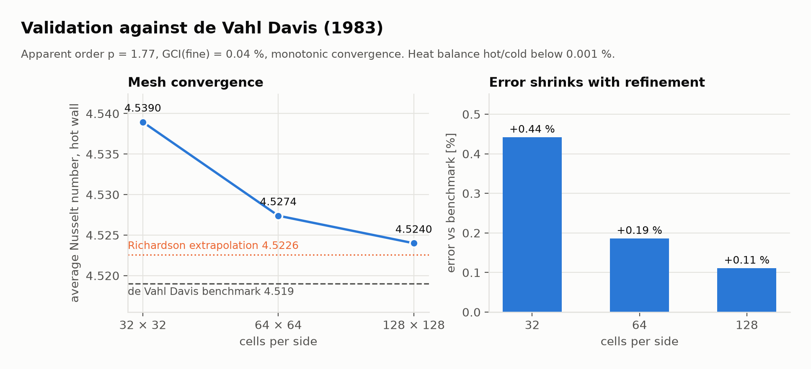
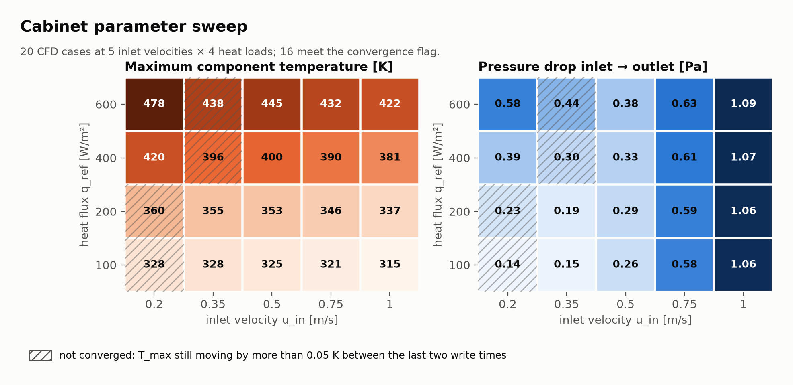

# Natural convection (Buoyancy-driven) CFD simulation, validated, with an ML surrogate

**OpenFOAM (ESI v2606) · Gmsh · Python · scikit-learn**

> *This project was carried out with AI assistance (Claude Code).*


## What this project is

Electronics cabinets are cooled by air that moves because it is pushed (a fan) and because it is hot (buoyancy). Predicting the hottest component temperature normally needs a CFD run that takes minutes to hours. This project asks three questions and answers them in order:

1. **Can I trust my OpenFOAM buoyancy setup?** I test it on a famous benchmark with a known answer: the differentially heated square cavity (de Vahl Davis, 1983).
2. **How does a cabinet respond to airflow and heat load?** I build a parametric 2D cabinet with three heat-emitting components and run 20 steady simulations over a grid of inlet velocities and heat loads (and re-run the four that turn out to be unsteady with a transient solver).
3. **Can a small model replace the CFD?** I train a small neural network (a *surrogate*) on the 16 converged results to predict the maximum component temperature and the pressure drop instantly.

It carries over the workflow of my Master's thesis (parametrised CFD cases, correlation of results, validation) to an open-source toolchain that runs on a laptop.

## Results at a glance

| | Result |
|---|---|
| **Validation** | Hot-wall Nusselt number 4.524 on the finest mesh vs 4.519 in the benchmark: **+0.11 %**. Hot/cold heat balance below 0.001 %. |
| **Mesh convergence** | Error 0.44 % → 0.19 % → 0.11 % over three meshes; GCI(fine) = 0.04 %. |
| **Cabinet sweep** | 20 cases, **16 meet my steady convergence criterion, 4 do not**. Those 4 are unsteady (low velocity, buoyancy-dominated): I re-ran them transient, and their time-averaged T_max is 8 to 47 K higher than the steady value. T_max of the 16 converged cases: 315 K to 478 K, pressure drop 0.15 Pa to 1.09 Pa. |
| **Surrogate** | Trained on the 16 converged cases only. Leave-one-out R² = 0.998 (temperature rise) and 0.995 (pressure drop). About 10⁶ times faster than one CFD run. |

The honest caveats are in [Limitations](#limitations); please read them before using any number.

## Contents

- [Quick start](#quick-start)
- [Repository layout](#repository-layout)
- [Part 1: validation on the heated cavity](#part-1-validation-on-the-heated-cavity)
- [Part 2: the cabinet and its parameter sweep](#part-2-the-cabinet-and-its-parameter-sweep)
- [Part 3: the surrogate model](#part-3-the-surrogate-model)
- [Decisions and what I changed](#decisions-and-what-i-changed)
- [Assumptions and simplifications](#assumptions-and-simplifications)
- [Limitations](#limitations)
- [Porting notes](#porting-notes) · [References](#references) · [License](#license)

## Quick start

Requirements: OpenFOAM ESI **v2606** ([openfoam.com](https://www.openfoam.com); not the Foundation releases, where several names differ, see [Porting notes](#porting-notes)), Python 3.9+, Linux or WSL2. Everything runs on a laptop.

```bash
# one-time: Python packages (a virtualenv avoids the "externally managed environment" error)
python3 -m venv ~/.venvs/cabinet && source ~/.venvs/cabinet/bin/activate
pip install -r requirements.txt

source /usr/lib/openfoam/openfoam2606/etc/bashrc   # or the path of your own install
sh scripts/check_env.sh                            # must end with "Environment ready."

./run_all.sh smoke                  # quick check that both cases run (cavity at the N in meshParams + one coarse cabinet case)
./run_all.sh cavity                 # 3-mesh study            -> results/cavity_*  and docs/img/cavity_*
JOBS=2 ./run_all.sh cabinet         # mesh + 20 cases         -> results/sweep_results.csv
python3 scripts/continue_unconverged.py   # continue the unconverged cases with lower relaxation and 2000 more iterations
JOBS=2 ./run_all.sh transient       # transient re-run of the cases still unconverged + animation + recirculation check
./run_all.sh ml                     # surrogate + summary     -> results/RESULTS.md

python3 -m unittest discover -s tests   # unit tests of the Python helpers (no OpenFOAM needed)
```

## Repository layout

```
validation_cavity/     OpenFOAM case: Ra = 1e5 cavity (blockMesh, laminar buoyantSimpleFoam)
  case_params.json     fluid properties, temperatures, L, reference Nu (single source of truth)
cabinet_case/          OpenFOAM template for the cabinet
  transient_template/  transient (PIMPLE) dictionaries for run_transient.py
  0.orig/              initial fields with @placeholders@ for inlet velocity and heat fluxes
  Allmesh, Allclean    Gmsh -> gmshToFoam -> patch types -> checkMesh
run_all.sh             entry point: smoke | cavity | cabinet | transient | ml | all
scripts/
  check_env.sh         preflight: OpenFOAM environment, tools, Python packages
  check_rayleigh.py    verifies that the cavity really has Ra = 1e5
  mesh_study.py        3-mesh study: Nu, error vs benchmark, GCI
  extract_nusselt.py   Nu from the wallHeatFlux output + hot/cold heat balance
  gci.py               Grid Convergence Index (Celik et al. 2008)
  make_cabinet_mesh.py Gmsh (Python API): geometry, patches, size field
  fix_boundary.py      sets wall / empty / patch types after gmshToFoam
  run_sweep.py         parametric sweep: copy case, fill placeholders, run, collect
  continue_unconverged.py continuation of non-converged cases: lower relaxation, restart, run on
  run_transient.py     transient (buoyantPimpleFoam) re-run of the cases that stay unconverged
  make_movie.py        restarts the transient cases with fine output and renders docs/img/transient_cabinet.gif
  recirculation.py     share of cells with reverse vertical flow, per case
  parse_foam.py        reads patch values and run time from ASCII OpenFOAM output
  train_surrogate.py   MLP surrogate, hold-out + leave-one-out, speed-up
  make_figures.py      builds every figure in docs/img/ from the real data
  summarize_results.py collects all numbers into results/RESULTS.md
tests/                 unit tests for the Python helpers
results/               CSVs, JSON and RESULTS.md written by the scripts (solver output itself is not stored in the repo)
docs/img/              figures used in this README
```

## Part 1: validation on the heated cavity

### The benchmark

A square box of air, hot on the left wall, cold on the right, insulated top and bottom. The hot air rises along the left wall, the cold air sinks along the right wall, and a circulation sets up. The strength of the buoyancy is set by the Rayleigh number; I use **Ra = 10⁵**. The quantity of interest is the **average Nusselt number** Nu on the hot wall, which is the heat actually transferred divided by what pure conduction would transfer. de Vahl Davis (1983) published a reference value of **4.519** for this case.

If my solver, boundary conditions and numerics are right, I must get close to 4.519, and the error must shrink when the mesh is refined.

| Item | Value |
|---|---|
| Geometry | square, L = 0.10116 m, one cell in z (`empty` front/back) |
| Fluid | air, ideal gas, μ = 1.8e-5 Pa s, Cp = 1005 J/(kg K), Pr = 0.71 |
| Walls | hot 300.5 K (x = 0), cold 299.5 K (x = L), top and bottom adiabatic, no-slip |
| Dimensionless numbers | Ra = g β ΔT L³ / (ν α) = 1.0e5, Pr = 0.71 (checked by `scripts/check_rayleigh.py`) |
| Solver | `buoyantSimpleFoam` (steady SIMPLE), laminar |
| Schemes | steady state, bounded Gauss `linearUpwind` for U and h |
| Relaxation | 0.3 for U and h, 0.7 for p_rgh |
| Mesh | wall-clustered single block, N = 32, 64, 128 cells per side (refinement ratio 2) |
| Metric | Nu = Q / (κ ΔT depth), with Q the heat flow from the `wallHeatFlux` function object |


*Left: temperature as θ = (T − T_cold)/(T_hot − T_cold) with isotherms every 0.1. Right: speed with streamlines. The hot wall drives a clockwise circulation, with thin fast boundary layers on the side walls and a core that splits into two vortices.*

### Results

| N | cells | Nu | error vs 4.519 |
|---|---|---|---|
| 32 | 1 024 | 4.539 | +0.44 % |
| 64 | 4 096 | 4.527 | +0.19 % |
| 128 | 16 384 | 4.524 | +0.11 % |

Apparent order of convergence p = 1.77, Richardson-extrapolated Nu = 4.5226, **GCI(fine) = 0.04 %**, convergence is monotonic. The hot/cold heat balance is below 0.001 %. (Source: `results/cavity_mesh_study.csv`, `results/cavity_gci.json`.)



**How to read this.** The three Nusselt numbers move steadily toward the benchmark as the mesh is refined, and the extrapolated value (4.5226) is 0.08 % from the reference. That is the behaviour I expect from a correct setup.

**About the benchmark value.** 4.519 is the value in `case_params.json`. A search confirmed it as the de Vahl Davis reference for Ra = 10⁵ in a comparison table of a secondary source ([Spectral element simulations of buoyancy-driven flow](https://arxiv.org/pdf/physics/0305049)). I did not check it against the original paper's table.

**What differs from the benchmark.** The benchmark assumes the Boussinesq approximation; my case uses a weakly compressible ideal gas with ΔT = 1 K, a small effect. The steady runs stop at a finite iteration count; none met my strict residual limits (U 1e-7, h 1e-8), so I judge convergence on the heat flux instead: at N = 128 it changes by less than 1e-5 (relative) over the last 1500 iterations (1.15265e-3 W to 1.15266e-3 W), and the heat balance is below 0.001 %.

## Part 2: the cabinet and its parameter sweep

### The model

- A 2D section of a cabinet, 0.6 m wide and 1.2 m tall, 0.1 m deep, with a 0.2 m inlet slot in the bottom wall and a 0.2 m outlet slot in the top wall.
- Three rectangular components (0.2 m × 0.15 m) that emit a prescribed heat flux: `q1 = q_ref`, `q2 = 0.6 q_ref`, `q3 = 0.3 q_ref`.
- Air at 293.15 K enters at velocity `u_in`; the cabinet shell is adiabatic.
- `buoyantSimpleFoam`, steady, k-ω SST turbulence with wall functions, 22 636 cells (one cell through the thickness), made in Gmsh with small cells at walls and components and large cells in the free stream.
- Sweep: `u_in` ∈ {0.2, 0.35, 0.5, 0.75, 1.0} m/s × `q_ref` ∈ {100, 200, 400, 600} W/m² = **20 cases**.
- Outputs per case: maximum component temperature `T_max_K`, pressure difference inlet to outlet `dp_Pa` (from `p_rgh`, so the hydrostatic part is excluded), a convergence flag, and the solver time.

The figure at the top of this page shows three of the converged cases: slow air with high load (left), medium (centre), fast air (right). With fast air the hot spots are limited to thin layers on the component faces; with slow air they spread into a warm plume.

### Sweep results



*Maximum component temperature (left) and pressure drop (right) over the 5 × 4 grid. Hatched cells did not meet the convergence criterion.*

Two patterns are visible: more heat gives a higher T_max at every velocity, and T_max generally falls as the velocity rises (not strictly in every cell, and several of the cells that break the trend are the non-converged ones). The pressure drop depends mainly on velocity: about 1.06 to 1.09 Pa at 1 m/s and 0.15 to 0.59 Pa at 0.5 m/s or less (converged cases).

### Convergence: which cases to trust

I call a case **converged** when `T_max` changed by less than 0.05 K between the last two write times. After the main sweep (8000 iterations) **14 of 20 cases met this**. I then continued each of the 6 others, one at a time, with lower relaxation (U and h 0.15 → 0.1, k and ω 0.3 → 0.2), restarted from the saved state and run for 2000 more iterations (to 10000). This is `scripts/continue_unconverged.py`. The outcome:

| Case | After the main sweep (8000 iterations) | After continuation (10000 iterations) |
|---|---|---|
| `u0.75_q600` | not converged | **converged**, residuals about 1e-6 |
| `u0.2_q400` | not converged | **converged**, but marginal: it passes the 0.05 K test while the residuals are still about 2.5e-4 |
| `u0.2_q100` | not converged | not converged |
| `u0.2_q200` | not converged | not converged |
| `u0.35_q400` | not converged | not converged |
| `u0.35_q600` | not converged | not converged |

**16 of 20 cases now meet the criterion; these 4 do not:** `u0.2_q100`, `u0.2_q200`, `u0.35_q400`, `u0.35_q600`. They are kept in `results/sweep_results.csv` (column `converged`) and hatched in the figure above; I did not drop them from the data, only from the surrogate training set (Part 3). The state after the main sweep is kept next to the final values in the columns `T_max_8000it_K`, `dp_8000it_Pa` and `converged_8000it`.


*Residual histories of one converged and one non-converged case from the main sweep, same solver settings. Left: the residuals keep falling. Right: they stall at 1e-4 to 1e-3.*

The four remaining cases looked like a flow that keeps oscillating, not one that is slowly settling: over the last five write times (iterations 8750 to 10000) `T_max` still varied by 0.8 K (`u0.2_q100`), 1.7 K (`u0.2_q200`), 5.1 K (`u0.35_q400`) and 3.0 K (`u0.35_q600`), and the residuals stayed at 1e-4 to 3e-4. More iterations at lower relaxation did not change that, so I tested the explanation with a transient solver (next section).

### The four stubborn cases, run transient

**Why I switched from a steady to a transient solver.** A steady solver (`buoyantSimpleFoam`) looks for one fixed flow field. For these four cases it never found one: after 8000 iterations `T_max` kept changing between saved iterations, the residuals stalled at 1e-4 to 3e-4 instead of falling, and lowering the relaxation and adding 2000 iterations did not help. That pattern points to a flow that is physically unsteady, where no single steady answer exists, not to a solver that needs more time. A transient solver (`buoyantPimpleFoam`) follows the flow through time and can test this directly. It did: the flow fluctuates, and its time average is a well-defined result.

`scripts/run_transient.py` re-runs each of the four with `buoyantPimpleFoam` (implicit Euler, Courant number below 0.8, same mesh, properties and boundary conditions), starting from the last steady fields and running for 100 s of flow time. It records `T_max` and the pressure drop at every time step (`results/transient_results.csv`). Statistics use the second half of the run; I discarded the first half as start-up.

| Case | T_max steady (K) | T_max transient: mean (K) | std (K) | min to max (K) | Mean drift between the last two quarters (K) | dp steady (Pa) | dp transient mean (Pa) |
|---|---|---|---|---|---|---|---|
| `u0.2_q100` | 328.4 | 336.4 | 1.8 | 333.7 to 341.4 | 0.03 | 0.140 | 0.106 |
| `u0.2_q200` | 360.0 | 371.9 | 3.0 | 365.3 to 378.4 | 0.01 | 0.226 | 0.188 |
| `u0.35_q400` | 396.1 | 428.7 | 6.6 | 420.4 to 451.0 | 0.11 | 0.296 | 0.263 |
| `u0.35_q600` | 438.1 | 484.8 | 8.4 | 473.6 to 514.8 | 0.04 | 0.441 | 0.349 |

What this shows:

- **The flow really is unsteady.** T_max fluctuates with a standard deviation of 1.8 to 8.4 K, and the fluctuation grows with heat load and velocity in this set. A steady solver has no fixed point to reach, which explains the stalled residuals.
- **The steady values were not just noisy, they were biased low.** The transient mean T_max is 8 to 47 K higher than the last steady iterate, and the mean pressure drop is 0.03 to 0.09 Pa lower. The steady numbers for these four cases in `results/sweep_results.csv` should therefore not be used.
- **The averages are stationary** (the mean changes by 0.01 to 0.11 K between the last two quarters of the averaging window), so the transient means are well-defined values. I have **not** used them for the surrogate, and I have not tested sensitivity to the time step, the 100 s length, or the convection scheme (the transient runs use `linearUpwind` for U and `limitedLinear` for h, not the `upwind` of the steady sweep, so the two sets are not like-for-like).


*25 s of flow time (t = 100 to 125 s) of the four cases, one column each. Top: temperature (linear colour scale, fixed per case). Middle: speed. Bottom: T_max of the hottest component face, with the part already played drawn in orange. Made by `scripts/make_movie.py`: I restarted each case from t = 100 s and wrote a field every 0.25 s.*

In the animation the speed field shows swirling structures that keep changing shape and position between frames, and the T_max curves show repeated spikes every few seconds (roughly periodic, not random). The temperature field changes more subtly, because the hot air stays in thin layers close to the components. This continuing motion is what the steady solver could not settle on. The GIF is about 5.5 MB; each frame is real solver output, nothing is interpolated.

### Does low velocity cause flow separation?

I expected that low inlet velocity would give more recirculation, so I checked (`scripts/recirculation.py`, `results/recirculation.csv`). As a crude indicator I counted the share of cells whose vertical velocity points downward, against the main upward flow:

| Inlet velocity (m/s) | Cells with downward flow (mean over the 4 heat loads, steady runs) |
|---|---|
| 0.2 | 26.2 % |
| 0.35 | 31.5 % |
| 0.5 | 33.3 % |
| 0.75 | 31.0 % |
| 1.0 | 30.0 % |

**Recirculation is present at every velocity: roughly a quarter to a third of the cabinet cells have reverse vertical flow, and that share is not larger at low velocity.** The strength of the reverse flow scales with the inlet velocity (the strongest downward velocity is about 0.6 × u_in at 1 m/s). So with this indicator the data do not show that low velocity gives *more* separation. What does change at low velocity is that the flow becomes unsteady. At 0.2 to 0.35 m/s the buoyant plume off the hot components is strong relative to the forced flow, the separated regions oscillate instead of staying fixed, and a steady solver cannot converge. The indicator is simple (it also counts ordinary downflow near walls), so I would treat it as supporting evidence, not as a separation analysis.

## Part 3: the surrogate model

A **surrogate** is a cheap model that imitates an expensive simulation. Here it is a small neural network (multilayer perceptron) with two inputs, `u_in` and `q_ref`, two hidden layers of 16 tanh units, trained with L-BFGS on standardised inputs and outputs. Its two outputs are the maximum temperature rise above the inlet and the pressure drop.

**Training data: the 16 converged cases only.** The 4 non-converged cases are excluded (`--converged-only`, which `run_all.sh ml` uses), because their CFD values are still moving and a surrogate cannot be better than its training data. Two checks, both on the 16 cases:

| Target | R² hold-out (4 cases) | MAE hold-out | R² leave-one-out (16 cases) | MAE leave-one-out |
|---|---|---|---|---|
| T_max rise [K] | 0.960 | 6.40 K | 0.998 | 1.52 K |
| dp [Pa] | 0.667 | 0.121 Pa | 0.995 | 0.0121 Pa |

*Leave-one-out* means: train on 15 cases, predict the 16th, repeat for every case. The hold-out split has only 4 test cases, so its numbers are very noisy and depend on which 4 cases happen to be in the split; I trust leave-one-out more.


*Predicted against CFD value; the dashed line is a perfect prediction. Blue: the 16 training cases, each predicted by a model that never saw it. Orange diamonds: the 4 excluded cases, predicted by the final model and not scored.*

**How the training set affected the result.** I trained the surrogate on three training sets as the CFD data improved. These are leave-one-out scores, computed on different case sets, so they are not strictly comparable:

| Training data | T_max rise, R² / MAE | dp, R² / MAE |
|---|---|---|---|
| all 20 cases after the main sweep | 0.970 / 4.20 K | 0.993 / 0.0166 Pa |
| 14 cases converged after the main sweep | 0.974 / 3.97 K | 0.935 / 0.0328 Pa |
| **16 cases converged after continuation (current)** | **0.998 / 1.52 K** | **0.995 / 0.0121 Pa** |

*All three are in `results/surrogate_training_sets.json`; the current one is also `results/surrogate_metrics.json`.*

With 14 cases the pressure-drop fit was poor, mostly because of one case, `u0.2_q600` (0.585 Pa), which sits in the corner of the sweep (lowest velocity, highest load) and was predicted as 0.28 Pa. After the continuation runs added `u0.2_q400` and `u0.75_q600` to the training set, it is predicted as 0.51 Pa and the case carries 37 % of the dp error instead of about two thirds. I think the extra neighbours in that corner are the reason, but I have not tested it separately.

**The excluded cases as a sanity check.** The final model predicts the 4 excluded cases with a mean error of 10.1 K and 0.017 Pa. This is only a weak check, since their CFD values are themselves unreliable.

**Speed-up.** One CFD case takes 375 s on average (mean over all 20 cases, including the continuation runs), one prediction takes 0.22 ms: roughly **10⁶ times faster** per evaluation. This does not count the CFD runs needed to train the model first, so the surrogate pays off only when many evaluations are needed.

**Caveats.** The model is valid only inside the sampled range (0.2 to 1.0 m/s, 100 to 600 W/m²) and must not be used to extrapolate. The training set has only 16 points, and one of the 16, `u0.2_q400`, only just passes the convergence test.

## Decisions and what I changed

The case files were first written without access to an OpenFOAM installation, so the first runs needed debugging. Only numerics were changed; **no physical setting (geometry, ΔT, properties, boundary conditions) was changed.**

| Where | Change | Why |
|---|---|---|
| Cavity `fvSolution` | p_rgh solver GAMG → PCG with DIC | GAMG stalled at an absolute residual of about 2e-6 and used all 1000 iterations every step. PCG needs about 20 iterations and was about 4× faster per step in a test. |
| Cavity `controlDict` | `endTime` 8000 → 40000 | At 8000 iterations the N = 128 run was still converging (Nu 4.166, −7.8 %). With 40000 it reached 4.524. |
| Cabinet `fvSolution` | relaxation of U and h 0.3 → 0.15 | With 3000 iterations and relaxation 0.3, 18 of 20 cases did not converge. |
| Cabinet `fvSchemes` | `div(phi,U)` and `div(phi,h)` from `linearUpwind` to `upwind` | I changed this together with the relaxation and did not test the two separately. **`upwind` is less accurate (more numerical diffusion) than `linearUpwind`, so cabinet temperatures are somewhat smeared.** |
| Cabinet `controlDict` | `endTime` 3000 → 8000 | More iterations for the slow cases. |
| Transient re-run of 4 cases (`runs_transient/`) | `buoyantPimpleFoam`, implicit Euler, maxCo 0.8, `linearUpwind` for U, `limitedLinear` for h, 100 s flow time | The steady solver cannot converge an oscillating flow. Same physics; only the solver and schemes differ. |
| Continuation of 6 cases (per case, run directory only) | relaxation of U and h 0.15 → 0.1, k and ω 0.3 → 0.2, restart from 8000, run to 10000 | For the cases still not converged after the main sweep: 2 of 6 converged, 4 did not (see Part 2). The template in `cabinet_case/system/` keeps the sweep settings. |

Result of the changes: the share of converged cabinet cases went from 2 of 20 (3000 iterations, relaxation 0.3) to 14 of 20 (main sweep) and then 16 of 20 (continuation); see Part 2.

Other choices, and the reasons I can give for them: the cavity uses a refinement ratio of 2 because it is the cleanest case for the GCI procedure; the sweep meshes once and copies the mesh into every case because the geometry never changes; the surrogate is deliberately small because 20 points cannot support a large model; and I report leave-one-out next to the hold-out split because 4 test points are noisy. The comments in `scripts/` explain these choices where they are made.

## Assumptions and simplifications

Everything below is a modelling choice I made, not a measured fact. The effect column says what it can change in the results.

| Area | Assumption or simplification | Effect on the results |
|---|---|---|
| Geometry | The cabinet is a generic 2D section (0.6 m × 1.2 m, three equal rectangles, inlet and outlet slots in line), one cell thick with `empty` front and back. It is not a model of a real product. | Components behave like infinitely long bars; there is no flow in the third direction. Absolute values do not transfer to a real cabinet. |
| Heat sources | Each component has a uniform, prescribed heat flux (`q1 = q_ref`, `q2 = 0.6 q_ref`, `q3 = 0.3 q_ref`). The 1 : 0.6 : 0.3 split is my choice. | The component surface temperature is a result, not an input. There is no conduction inside the components and no heat spreading, so hot spots are probably sharper than in reality. |
| Shell | Cabinet walls are adiabatic and no-slip. | No heat is lost through the shell, which overestimates temperatures. |
| Radiation | Not modelled. | Underestimates heat removal, so temperatures are higher than with radiation. |
| Air properties | Ideal gas with constant μ = 1.8e-5 Pa s, Cp = 1005 J/(kg K), Pr = 0.71 (no temperature dependence), pressure 1e5 Pa. | At the hottest component faces (up to about 515 K in the transient runs) the real viscosity and conductivity are larger. |
| Buoyancy | Weakly compressible ideal gas with density from the equation of state, in both cases (the benchmark itself assumes Boussinesq). Gravity is 9.81 m/s² along −y. | In the cavity, ΔT = 1 K keeps the difference to Boussinesq small. In the cabinet the density change is real but not compared with a Boussinesq run. |
| Inlet | Uniform velocity `u_in` and uniform temperature 293.15 K. The outlet is at fixed 1e5 Pa and allows reverse flow (`inletOutlet`). | Real inlets have a velocity profile. Air that flows back in through the outlet enters at 293.15 K, which may be cooler than in reality. |
| Turbulence | RANS k-ω SST with wall functions, fully turbulent. Inlet k = 1e-3 m²/s² and ω = 4 1/s are fixed values I chose, not derived. | The slot Reynolds number is about 2600 at 0.2 m/s and 13 000 at 1 m/s (computed from the air properties above), so the slow cases are in the transitional range where a fully turbulent model is questionable. The same k gives a turbulence intensity of about 13 % at 0.2 m/s and 2.6 % at 1 m/s, so the inlet turbulence is not the same across the sweep. I did not test the sensitivity to these values. |
| Wall treatment | Wall functions (`nutkWallFunction`, `omegaWallFunction`, turbulent Prandtl number 0.85) on a mesh without prism layers. | y⁺ varies along the walls and was not checked. This affects heat transfer near the components. |
| Cavity | Laminar, 2D, one cell thick, adiabatic top and bottom, ΔT = 1 K. | Matches the benchmark conditions except for the compressibility noted above. |
| Mesh | One Gmsh mesh with 22 636 cells for the whole sweep. The cavity uses three refinement levels. | There is no mesh study for the cabinet, so its discretisation error is unknown. |
| Numerics | The steady sweep uses first-order `upwind` for U and h. The transient runs use `linearUpwind` for U and `limitedLinear` for h. | Upwind smears temperature; the steady and transient results are not like-for-like. |
| Convergence | A steady case counts as converged when `T_max` changes by less than 0.05 K between the last two write times, 250 iterations apart. | A loose criterion. One of the 16 accepted cases only just passes it. |
| Unsteady cases | The 100 s transient runs start from the last steady fields and average over the second half. | Not tested for sensitivity to time step, run length or start state. |
| Quantities | `T_max` is the largest temperature among the component face values. `dp` is the average `p_rgh` at the inlet minus the outlet, so the hydrostatic part is excluded. | `T_max` is a face value, not a thermocouple reading. It depends on the wall treatment above. |
| Surrogate | A small neural network on a 5 × 4 grid of two parameters (16 usable points), trained and tested on my own CFD, not on experiments. | Valid only inside the sampled range, and only as accurate as the CFD that trained it. |

## Limitations

**The main constraint is computing budget.** I set the project up on purpose to run on a laptop with two cores and open-source tools only, so that anyone can reproduce it. That choice fixes the scope. For scale, one cabinet case takes about 6 minutes, the cavity study about 27 minutes, and each transient case 38 to 68 minutes (all measured on 2 cores). A 3D model, finer meshes, or a larger sweep would multiply these times, which is why the study stays 2D, uses one cabinet mesh and covers a 5 × 4 grid. The results should be read as a validated workflow on a reduced problem, not as a design-ready prediction for a real cabinet. The table separates what the limited budget caused from what I simply did not do.

| Limitation | Cause | What I would do next |
|---|---|---|
| **2D section of a 3D problem.** Absolute temperatures and pressure drops are not representative of a real cabinet. | Computing budget: a 3D mesh with the same resolution needs far more cells and run time than a two-core laptop handles comfortably. | Build a 3D case and check how much the 2D numbers change. |
| **No mesh study for the cabinet** (one mesh of 22 636 cells). | Computing budget: three meshes for 20 steady cases plus the transient runs would multiply the run time. The cavity does have a full 3-mesh study and GCI. | Repeat a few representative cases on a coarser and a finer mesh. |
| **Four of the 20 cabinet cases are unsteady** and cannot be converged with a steady solver. Their steady values are biased low (see the transient table). The surrogate is trained without them, which leaves 16 points. | Physics of the problem, not a budget issue. I resolved it with a transient solver, which is the expensive part. | Longer transient runs and a transient sweep, so the unsteady region is part of the surrogate. |
| **Transient runs not tested for sensitivity** to time step, run length or convection scheme. They use different schemes from the steady sweep. | Computing budget: each transient case already takes 38 to 68 minutes, and a sensitivity study needs several more runs per case. | Vary the time step and run length for one case and compare the time averages. |
| **First-order `upwind` in the steady sweep.** Robust but diffusive: temperatures are smeared. | I switched to it for robustness, together with lower relaxation, when the first sweep did not converge. I did not test the two changes separately, so I cannot say how much each helped. | Re-run the converged cases with `linearUpwind` once a good starting field exists. |
| **Surrogate trained on 16 points of a 2-parameter space:** valid only inside the sampled range, and the hold-out score rests on 4 cases. | Each training point is one CFD run, so the number of points is limited by the same budget. | More points, especially in the low-velocity corner, and a model that also covers the transient cases. |
| **Simplified physics:** prescribed heat flux and no solid conduction, adiabatic shell, no radiation, constant air properties, fully turbulent model (see the table above). | Scope: each addition (conjugate heat transfer, radiation, variable properties) is a larger model that I did not build. | Add conjugate heat transfer and radiation, and test the sensitivity to inlet turbulence. |
| **Wall functions without prism layers:** y⁺ varies and I did not check it with `postProcess -func yPlus`. | Not done in this study. It needs no extra run, only a post-processing step. | Run `yPlus` and refine the near-wall mesh where needed. |
| **Convergence criteria:** the hot/cold heat balance (cavity) and the T_max change between write times (cabinet) are the only criteria I applied beyond the residuals. | Scope: a simple, transparent test that I can state in one sentence. | Add monitors of integral quantities over the last iterations. |
| **Benchmark value** 4.519 was confirmed in a secondary source, not in the original paper. | I checked only a secondary source that tabulates the value. | Check against the 1983 table. |

## Porting notes

- `constant/momentumTransport` and `constant/turbulenceProperties` are both present; the release reads one of them and ignores the other.
- Other ESI releases (v2306 and newer) should work with the same files. For OpenFOAM Foundation releases use `buoyantFoam` with `steadyState` ddt schemes (or the `foamRun` modules in newer versions), and expect different names for the `wallHeatFlux` output and for some thermo and boundary-condition keywords.

## References

- G. de Vahl Davis, "Natural convection of air in a square cavity: a bench mark numerical solution", *Int. J. Numer. Methods Fluids* 3 (1983) 249-264.
- I. B. Celik et al., "Procedure for estimation and reporting of uncertainty due to discretization in CFD applications", *J. Fluids Eng.* 130 (2008) 078001.

## License

MIT, see `LICENSE`.
